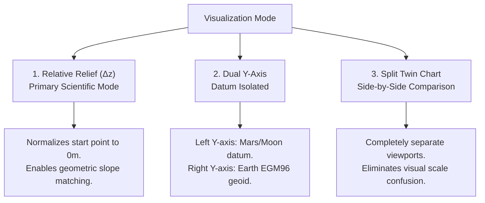

# Planetary Elevation Profile & Topographic Relief Methodology
## Geodesic Sampling, Binary Altimetry & Scientific Datum Isolation

This document describes the mathematical and physical foundations of the Topographic Elevation Profile Comparison Engine in TerraTwin.

---

## 1. The Fundamental Scientific Challenge: Incompatible Planetary Datums

A common error in planetary visualization tools is plotting Earth, Moon, and Mars elevations on a single vertical axis as if they shared a common zero-level. In reality, each planetary body possesses a distinct physical reference datum:

| Body | Reference Datum | Mathematical Definition | Physical Significance |
| :--- | :--- | :--- | :--- |
| **Mars** | **IAU2000 Areoid** | Spherical harmonic gravitational potential surface ($V = \text{const}$) | Equipotential surface where mean atmospheric pressure equals the triple point of water ($610.5\text{ Pa}$). |
| **Moon** | **Reference Sphere** | Perfect sphere with radius $R = 1,737.4\text{ km}$ | The Moon lacks an atmosphere or ocean to define an equipotential sea level; altimetry is radial distance relative to the mean radius. |
| **Earth** | **EGM96 Geoid** | Gravitational equipotential surface approximated by Mean Sea Level (MSL) | Standard orthometric height datum for terrestrial topographic surveys. |

> [!WARNING]
> Directly overlaying lunar radial elevations (e.g. $+100\text{ m}$ relative to $1,737.4\text{ km}$) with Martian areoid depths (e.g. $-2,650\text{ m}$ in Jezero Crater) and terrestrial sea-level heights on a single vertical scale is physically meaningless without a justified mathematical transformation.

---

## 2. Geodesic Great-Circle Interpolation

To construct an authentic transect between start coordinate $(\phi_1, \lambda_1)$ and end coordinate $(\phi_2, \lambda_2)$ on a planetary body of radius $R$:

### A. Central Angle ($\sigma$)
$$\sigma = \arccos\big(\sin\phi_1 \sin\phi_2 + \cos\phi_1 \cos\phi_2 \cos(\lambda_2 - \lambda_1)\big)$$

### B. Geodesic Distance ($D$)
$$D = R \cdot \sigma$$

### C. Spherical Linear Interpolation (Slerp)
For $N$ sample points with fraction $t = \frac{i}{N-1}$ ($t \in [0, 1]$):
$$A = \frac{\sin((1 - t)\sigma)}{\sin\sigma}, \quad B = \frac{\sin(t\sigma)}{\sin\sigma}$$
$$x(t) = A \cos\phi_1 \cos\lambda_1 + B \cos\phi_2 \cos\lambda_2$$
$$y(t) = A \cos\phi_1 \sin\lambda_1 + B \cos\phi_2 \sin\lambda_2$$
$$z(t) = A \sin\phi_1 + B \sin\phi_2$$

Converting back to planetary coordinates:
$$\phi(t) = \arctan2\left(z(t), \sqrt{x(t)^2 + y(t)^2}\right)$$
$$\lambda(t) = \arctan2(y(t), x(t))$$

---

## 3. Altimetry Data Sources & Sampling

### A. Mars: MGS MOLA MEGDR Altimetry
- **Instrument**: Mars Orbiter Laser Altimeter on Mars Global Surveyor.
- **Product**: `MGS-M-MOLA-5-MEGDR-L3-V1.0` ($4\text{ to }128\text{ px/deg}$).
- **Binary Format**: 16-bit big-endian signed integers representing elevation in meters relative to the IAU2000 areoid.
- **Transects**: Geodesic traverses across crater rims to crater floors (Jezero delta fan, Gale Mt. Sharp mound, Meridiani hematite plains).

### B. Moon: LRO LOLA LDEM Altimetry
- **Instrument**: Lunar Orbiter Laser Altimeter on Lunar Reconnaissance Orbiter.
- **Product**: `LRO-L-LOLA-4-GDR-V1.0` ($4\text{ to }128\text{ px/deg}$).
- **Format**: Signed radial elevation relative to the $1,737.4\text{ km}$ lunar sphere.
- **Transects**: Plunge profiles from illuminated crater rims into permanently shadowed regions (Shackleton Crater Rim, Mare Tranquillitatis plains).

### C. Earth: Copernicus DEM 90m (`COP-DEM-GLO-90`) & SRTMGL1
- **Instrument**: C-Band InSAR (Sentinel-1 / TanDEM-X / Shuttle Radar).
- **Product**: 30-point authentic sampled elevation profiles for all 8 vetted Earth analog locations (`raw-data/earth/earth_elevation_transects.json`).
- **Datum**: Orthometric height above the EGM96 Geoid (Mean Sea Level).

---

## 4. Topographic Relief Mathematics

To compare landforms across planetary bodies without datum distortion, TerraTwin computes **Relative Relief ($\Delta z$)**:

### Relative Elevation at Step $i$:
$$\Delta z_i = z_i - z_0$$
Where $z_0$ is the elevation at the transect starting point. This normalizes both curves to $\Delta z = 0$ at the origin, enabling direct comparison of slope steepness, crater rim heights, and delta gradients.

### Total Topographic Relief ($R_{\text{total}}$):
$$R_{\text{total}} = \max_i(z_i) - \min_i(z_i)$$

### Point-to-Point Slope Gradient ($\theta_i$):
$$\theta_i = \arctan\left(\frac{|z_i - z_{i-1}|}{d_i - d_{i-1}}\right) \cdot \frac{180^\circ}{\pi}$$
Where $d_i$ is the cumulative distance along the transect in meters.

---

## 5. Supported Visualization Modes



---

## 6. API Route Specification (`/api/elevation`)

- **Method**: `GET` / `POST`
- **Query / Body Parameters**:
  - `targetId`: Target UUID or slug (`jezero`, `gale`, `meridiani`, `shackleton`, `mare-tranquillitatis`).
  - `candidateId`: Candidate UUID or slug (`salda`, `craters-of-the-moon`, `askja`, `rio-tinto`, `atacama`, `svalbard`, `haughton`, `mcmurdo`).
  - `points`: Number of sample points ($20, 35, 50$, default: $35$).
- **Response**:
  ```json
  {
    "success": true,
    "target": {
      "locationId": "a0000001-...",
      "locationName": "Jezero Crater Delta",
      "planetaryBody": "Mars",
      "datum": "Mars IAU2000 Areoid (MOLA GMM-3 Equipotential Datum, 610.5 Pa)",
      "totalDistanceKm": 34.2,
      "reliefM": 1238,
      "meanSlopeDeg": 4.8,
      "samples": [
        {
          "index": 0,
          "distanceKm": 0,
          "rawElevationM": -2100,
          "relativeElevationM": 0,
          "slopeDeg": 0
        }
      ]
    },
    "candidate": { ... },
    "scientificNotice": {
      "datumDisparityExplanation": "...",
      "relativeReliefRecommendation": "..."
    }
  }
  ```
