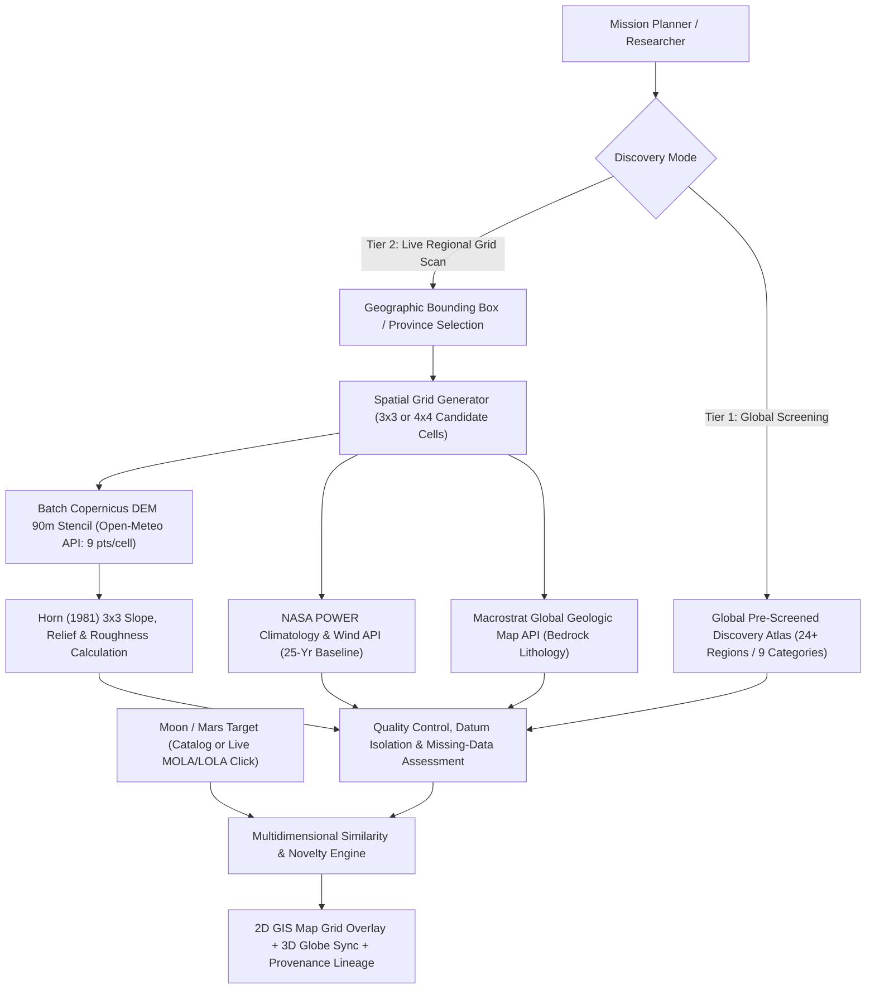

# TERRATWIN — GLOBAL ANALOG DISCOVERY ENGINE ARCHITECTURE

**Document ID:** `GLOBAL_ANALOG_DISCOVERY_ARCHITECTURE.md`  
**Audit Date:** November 14, 2026  
**Purpose:** Technical and scientific design for transforming TerraTwin into a systematic global and regional Earth analog discovery platform while preserving completed Phases 1–4.

---

## 1. Architectural Philosophy & Design Constraints

A credible planetary analog discovery engine must solve a fundamental geospatial tension:
- **Global High-Resolution Trap:** Processing global 30m DEMs ($\sim 1.5 \times 10^{11}$ land pixels) and global MODIS archives at full resolution in real time is computationally impossible in a web application or serverless environment.
- **Closed-List Trap:** Hardcoding 8 famous sites fails the core NASA Space Apps Challenge objective of *discovering potentially overlooked analogs*.

### The TerraTwin Two-Tier Hybrid Discovery Architecture
To achieve both **instantaneous global screening** and **live arbitrary regional discovery** within real API rate limits and serverless compute budgets, TerraTwin implements a **Two-Tier Hybrid Discovery Engine**:

---

## 2. Step-by-Step Pipeline Architecture (Stages A–H)

### Stage A — Geographic Search Area Selection
Users can initiate discovery in three ways:
1. **Global Geomorphological Category Screening (Tier 1):** Filter the Global Discovery Atlas across 9 candidate environment types (Salt Flats & Evaporites, Polar Deserts & Permafrost, Volcanic Fields, Impact Craters, High-Altitude Plateaus, Subglacial/Glacial Margins, Lava Tubes & Caves, Ancient Fluvial/Deltaic Basins, Hyper-Acidic/Alkaline Mineral Systems) and 6 continents.
2. **Predefined Geological Search Corridors (Tier 2 Preset Regions):** One-click bounding boxes over high-potential, under-explored tectonic/climatic belts (e.g., *Tibetan/Qaidam Hyper-Arid Plateau*, *Afar/Danakil Rift Basin*, *Andean Puna Salar Belt*, *Central Saharan Volcanic Massifs (Tibesti/Haruj)*, *Basin & Range Lunar Crater Belt*, *Deccan Basaltic Crater Province*).
3. **Interactive Map Bounding Box / Coordinate Radius Scan (Tier 2 Custom):** Click any point or draw a search box on the Leaflet Earth map (`latCenter, lonCenter, radiusKm` or `[minLat, minLon, maxLat, maxLon]`) to scan that region live.

### Stage B — Candidate-Region Generation (Spatial Grid Tessellation)
Given a bounding box $[\phi_{\min}, \lambda_{\min}, \phi_{\max}, \lambda_{\max}]$ and grid resolution $G \in \{3\times 3, 4\times 4\}$ ($9$ to $16$ candidate cells):
- Each candidate region $C_{r,c}$ is defined by:
  - Cell bounding box: $[\phi_{r}, \lambda_{c}, \phi_{r+1}, \lambda_{c+1}]$
  - Cell centroid: $(\phi_{r,c}^{\text{center}}, \lambda_{c}^{\text{center}})$
  - **Topographic $3\times 3$ Micro-Stencil:** 9 coordinates spaced at $\Delta s = 0.0025^\circ$ ($\approx 250\text{ m}$) around the centroid:
    $$S_{r,c} = \{ (\phi_{r,c}^{\text{center}} + i\Delta s, \; \lambda_{c}^{\text{center}} + j\Delta s) \mid i, j \in \{-1, 0, +1\} \}$$
- **Why this works within API limits:** For a $3\times 3$ candidate grid ($9$ cells), $9 \text{ cells} \times 9 \text{ stencil points} = 81$ coordinates. The Open-Meteo Copernicus DEM API accepts up to 100 coordinate pairs in a **single HTTP GET request** (`< 250 ms` total latency)!

### Stage C — Environmental Feature Extraction from Verified Datasets
For each generated candidate cell $C_{r,c}$:
1. **Topography, Slope & Roughness (Direct Measurement — Copernicus DEM GLO-90):**
   - From the 9-point elevation stencil $z_{i,j}$, compute:
     - Centroid Elevation: $z_0 = z_{0,0}$ (m, Earth EGM96 Geoid).
     - Horn (1981) $3\times 3$ Gradient Slope:
       $$\frac{\partial z}{\partial x} = \frac{(z_{-1,1} + 2z_{0,1} + z_{1,1}) - (z_{-1,-1} + 2z_{0,-1} + z_{1,-1})}{8 \Delta x}, \quad \frac{\partial z}{\partial y} = \frac{(z_{-1,-1} + 2z_{-1,0} + z_{-1,1}) - (z_{1,-1} + 2z_{1,0} + z_{1,1})}{8 \Delta y}$$
       $$\theta_{\text{slope}} = \arctan\left(\sqrt{\left(\frac{\partial z}{\partial x}\right)^2 + \left(\frac{\partial z}{\partial y}\right)^2}\right) \cdot \frac{180}{\pi}$$
     - Local Relief ($\Delta z_{\text{local}} = \max(z_{i,j}) - \min(z_{i,j})$) and Elevation Standard Deviation ($\sigma_z$).
   - **Ocean / Water Mask Safeguard:** If all 9 stencil points have $z_{i,j} \le 0\text{ m}$ and $\theta_{\text{slope}} = 0.0^\circ$ (open ocean), the cell is flagged `isOceanic: true` and excluded from terrestrial analog ranking.
2. **Climatology, Extremes, Solar Flux & Wind (Direct Measurement — NASA POWER API):**
   - Queries `https://power.larc.nasa.gov/api/temporal/climatology/point` (or regional grid cache) for parameters `T2M,T2M_MAX,T2M_MIN,PS,ALLSKY_SFC_SW_DWN,PRECTOTCORR,WS10M`.
   - Extracts:
     - `meanSurfaceTempC` ($^\circ\text{C}$)
     - `diurnalTempRangeC` ($^\circ\text{C}$)
     - `surfaceSolarIrradianceWm2` ($\text{W/m}^2$)
     - `annualPrecipitationMm` ($\text{mm/yr}$)
     - `surfacePressurePa` ($\text{Pa}$)
     - `meanWindSpeedMs` ($\text{m/s}$, 10m aeolian baseline)
3. **Bedrock Lithology (Direct Geological Map Query — Macrostrat API):**
   - Queries `https://macrostrat.org/api/v2/geologic_units/map?lat={lat}&lng={lon}&response=long`.
   - Maps returned IUGS lithology descriptors (`basalt`, `andesite`, `diabase`, `gabbro`, `anorthosite`, `tuff`, `ash`, `evaporite`, `gypsum`, `halite`, `shale`, `mudstone`, `carbonate`, `dolomite`, `limestone`, `granite`, `gneiss`, `impact breccia`) to TerraTwin's `Lithology` enum, recording the exact geological formation name and age in `qualityNotes`.
4. **Vegetation & Albedo Estimation (Calibrated Lookup or Proxy Classification):**
   - In the Tier 1 Discovery Atlas, `albedo` and `vegetationCoverPct` are populated from verified MODIS Terra (`MOD09GA` / `MOD13Q1`) retrievals.
   - In live Tier 2 bounding-box scans where real-time MODIS pixel extraction is not available via REST JSON, `vegetationCoverPct` can be estimated as an explicitly labeled **Climatic Aridity Proxy** (e.g., hyper-arid $\text{PRECTOTCORR} < 25\text{ mm/yr}$ or polar $T_{\text{mean}} < -10^\circ\text{C} \implies \text{vegetation} \le 2\%$) with `provenance.status = "illustrative"` / `classification = "PROXY_BASED"`, or left `null` when strict verified-only mode is selected.

### Stage D — Quality Control & Missing-Data Assessment
Every candidate cell undergoes automated QC before scoring:
1. **Sentinel Fill Filtering:** Rejects NASA POWER `-999` fill values and converts them to `null`.
2. **Coverage Calculation:** Computes `coverage` $= \sum_{i \in \text{valid}} w_i / \sum_{i \in \text{active}} w_i$.
3. **Strict Non-Fabrication Rule:** Unmeasured in-situ parameters (`medianGrainSizeMm`, `rockAbundancePct` in unvisited Tier 2 grid cells) are **never** replaced with zero or random numbers; they remain `null` (`status: "missing_data"`), and the candidate's `confidence` badge (`high` $\ge 90\%$, `moderate` $\ge 70\%$, `low` $\ge 40\%$, `insufficient` $< 40\%$) transparently reflects exact telemetry completeness.

### Stage E — Comparison with Supported Moon/Mars Targets (Including Custom Target Sampling)
- Candidates can be compared against any of the **5 canonical planetary targets** (`Jezero`, `Gale`, `Meridiani`, `Shackleton`, `Mare Tranquillitatis`) **OR** against **any custom planetary coordinate** $(\phi_{\text{target}}, \lambda_{\text{target}})$ clicked on the 3D Moon/Mars globe (which samples `elevationM`, `meanSlopeDeg`, `localReliefM`, and `elevationStdDevM` live from `megt90n000cb.img` or `ldem_4.img`).

### Stage F — Multidimensional Similarity, Mission Profiles & Novelty Ranking
1. **Four Mission Profiles Aligned with the Official Challenge:**
   - `rover-testing`: Mobility, slope, rock hazard, grain size, bare ground.
   - `geological-research`: Lithology, albedo, low vegetation, mineralogy.
   - `lunar-base-construction` (**NEW**): Permanent Moon Base & ISRU habitat siting—prioritizes low slope ($<5^\circ$), high solar irradiance (`surfaceSolarIrradianceWm2`), diurnal thermal stability, basaltic/anorthositic regolith feedstock, and low boulder hazard.
   - `astrobiology-habitability` (**NEW**): Extremophile & biosignature preservation—prioritizes clay/sulfate-evaporite lithology, hyper-aridity / low vegetation overprint, solar UV flux, and low topographic erosion slope.
2. **Novelty & Overlooked Analog Identification (`noveltyScore` & `analogTier`):**
   - Every candidate is classified into:
     - **`canonical-benchmark`**: Well-known NASA/ESA historical field testbeds (the original 8 sites).
     - **`under-explored-analog`**: Less-obvious terrestrial formations with high quantitative similarity ($S \ge 75\%$) located far from traditional field stations or under-represented in planetary analog trials.
     - **`live-grid-discovery`**: Dynamically screened spatial grid cells from Tier 2 regional scans.

### Stage G — Candidate Location Discovery & Map Visualization
- On the 2D Leaflet GIS Map (`analog-map-canvas.tsx`):
  - Discovered grid cells render both their **spatial bounding box rectangle** (`L.rectangle` colored by similarity score or environmental parameter) and their **centroid telemetry marker**.
  - Clicking any discovered grid cell loads it directly into the **Terrain Comparison Workspace**, **Geodesic Elevation Transect Profiler** (generating a live Copernicus DEM transect across the discovered cell!), and **Scientific Evidence Explorer**.

### Stage H — Scientific Explanation & Planetary Physics Failure Modes
For every candidate, TerraTwin explicitly documents:
1. **Why it matches:** Which specific physical dimensions (e.g., $\Delta\text{Slope} = 0.8^\circ$, identical sulfate-evaporite lithology, matching $195\text{ W/m}^2$ solar flux) drive its high similarity score.
2. **Where the Earth analog FAILS to reproduce planetary conditions:**
   - **Gravity Disparity:** Earth ($9.81\text{ m/s}^2$) vs. Mars ($3.72\text{ m/s}^2$, $0.38g$) vs. Moon ($1.62\text{ m/s}^2$, $0.165g$) — affects regolith angle of repose, wheel sinkage, and excavator bucket forces.
   - **Atmospheric & Vacuum Disparity:** Earth ($60\text{–}101\text{ kPa}$ $\text{N}_2/\text{O}_2$) vs. Mars ($0.6\text{–}0.9\text{ kPa}$ $\text{CO}_2$) vs. Moon ($10^{-10}\text{ Pa}$ hard vacuum) — eliminates convective heat transfer and alters dust electrostatic levitation.
   - **Radiation & Space Weathering:** Absence of micrometeoroid agglutinate glass and solar wind nanophase iron ($np\text{Fe}^0$) on Earth.

---

## 3. Step 4 — Catalog of Less-Obvious Earth Analog Environments (9 Challenge Categories)

To ensure TerraTwin looks well beyond famous sites (Atacama, Death Valley, McMurdo, Devon Island, Mauna Kea, Iceland), the **Tier 1 Global Discovery Atlas** systematically screens candidate regions across all **9 Official Challenge Analog Categories**:

| Category | Overlooked / Less-Obvious Candidate Region | Coordinates | Target Analog Affinity | Scientific & Operational Rationale |
| :--- | :--- | :--- | :--- | :--- |
| **1. Salt Flats & Evaporite Basins** | **Danakil Depression (Dallol Hydrothermal Field), Ethiopia** | $14.24^\circ\text{N}, 40.30^\circ\text{E}$ | Meridiani Planum / Gale Crater | Hyper-acidic ($\text{pH} < 1$), hypersaline iron-sulfate and halite evaporites; extreme polyextremophile habitability limit. |
| **1. Salt Flats & Evaporite Basins** | **Chott el Djerid Evaporite Basin, Tunisia** | $33.70^\circ\text{N}, 8.40^\circ\text{E}$ | Meridiani Planum | Ephemeral gypsum/halite sabkha plain with polygonal desiccation crusts and seasonal groundwater table upwelling. |
| **2. Polar Deserts & Permafrost** | **Axel Heiberg Island (Lost Hammer Spring), Nunavut, Canada** | $79.12^\circ\text{N}, -90.21^\circ\text{E}$ | Shackleton Rim / Mars High-Latitudes | Perennial sub-zero hypersaline cryo-springs discharging through $500\text{ m}$ thick continuous permafrost; cold-adapted anaerobic microbes. |
| **2. Polar Deserts & Permafrost** | **Peary Land (Brønlund Fjord Polar Desert), Northern Greenland** | $82.17^\circ\text{N}, -30.50^\circ\text{E}$ | Shackleton Crater / Lunar South Pole | High-Arctic ice-free polar desert with extreme low precipitation ($<45\text{ mm/yr}$), katabatic wind deflation pavements, and low sun angles. |
| **3. Volcanic Fields & Lava Landscapes** | **Waw an Namus Basaltic Caldera, Fezzan, Libya** | $24.92^\circ\text{N}, 17.77^\circ\text{E}$ | Mare Tranquillitatis / Lunar Dark Mantle | Isolated $4\text{ km}$ caldera surrounded by a $10\text{–}20\text{ km}$ apron of pitch-black basaltic tephra and olivine-rich ash (albedo $\sim 0.06$) in the hyper-arid central Sahara. |
| **3. Volcanic Fields & Lava Landscapes** | **Lunar Crater Volcanic Field (Black Rock Lava Flow), Nevada, USA** | $38.38^\circ\text{N}, -116.07^\circ\text{E}$ | Mare Tranquillitatis | Quarto-basaltic maar craters, cinder cones, and unweathered alkali basalt flows in an arid basin. |
| **4. Impact Craters** | **Lonar Crater, Maharashtra, India** | $19.98^\circ\text{N}, 76.51^\circ\text{E}$ | Jezero Crater / Lunar Mare Craters | One of the only terrestrial impact craters emplaced directly into **flood basalt** (Deccan Traps) containing an alkaline carbonate-evaporite lake. |
| **4. Impact Craters** | **Roter Kamm Impact Crater, Namib Desert, Namibia** | $-27.77^\circ\text{N}, 16.29^\circ\text{E}$ | Mare & Highland Simple Bowl Craters | $2.5\text{ km}$ diameter simple impact structure partially mantled by hyper-arid aeolian dune sands—ideal for studying crater rim burial and radar penetration. |
| **5. Arid High-Altitude Plateaus** | **Puna de Atacama (Campo de Piedra Pómez & Laguna Tuyajto), Argentina/Chile** | $-26.62^\circ\text{N}, -67.42^\circ\text{E}$ | Gale Crater / Martian Highlands | $>4,000\text{ m}$ elevation, extreme solar UV flux ($>310\text{ W/m}^2$), giant wind-carved ignimbrite yardangs, and high-altitude cryogenic diurnal swings. |
| **5. Arid High-Altitude Plateaus** | **Qaidam Basin (Mangya Aeolian Yardang Field), Qinghai, China** | $38.25^\circ\text{N}, 90.85^\circ\text{E}$ | Gale Crater / Medusae Fossae | Hyper-arid Tibetan plateau basin ($2,800\text{ m}$) featuring Earth's largest wind-eroded clay/sulfate yardang complexes and polygonal salt crusts. |
| **6. Glacial & Subglacial Environments** | **Vatnajökull Subglacial Geothermal Cauldrons (Skeiðarársandur), Iceland** | $64.02^\circ\text{N}, -17.25^\circ\text{E}$ | Martian Outflow Channels / Cryosphere | Jökulhlaup catastrophic glacial flood outwash plains depositing sorted basaltic gravel bars and ice-block kettle holes. |
| **7. Caves & Lava Tubes** | **Cueva de los Verdes / Corona Lava Tube, Lanzarote, Canary Islands, Spain** | $29.16^\circ\text{N}, -13.44^\circ\text{E}$ | Marius Hills / Mare Tranquillitatis Pits | $7\text{ km}$-long massive basaltic lava tube with multiple collapse skylights (*jameos*) up to $30\text{ m}$ wide—premier structural analog for lunar skylight base habitats. |
| **7. Caves & Lava Tubes** | **Undara Basaltic Lava Tube System, Queensland, Australia** | $-18.22^\circ\text{N}, 144.57^\circ\text{E}$ | Lunar Mare Lava Tubes | $160\text{ km}$ Cenozoic basaltic flow hosting $>60$ collapse depressions and intact $20\text{ m}$-diameter subsurface tubes. |
| **8. Dry River Systems & Ancient Sedimentary** | **Wadi Rum & Mudawarra Paleolake Beds, Southern Jordan** | $29.58^\circ\text{N}, 35.42^\circ\text{E}$ | Jezero Delta / Neretva Vallis |Incised ferric sandstone canyons debouching into desiccated Pleistocene lacustrine clay/evaporite flats with zero vegetation. |
| **9. Unusual Geological & Mineralogical Regions** | **Semail Ophiolite (Samail Ultramafic Serpentinization Zone), Oman** | $22.88^\circ\text{N}, 58.20^\circ\text{E}$ | Nili Fossae / Jezero Olivine-Carbonate | Exposed mantle peridotite undergoing active low-temperature serpentinization, generating hyper-alkaline ($\text{pH } 11\text{–}12$) $\text{H}_2/\text{CH}_4$-rich fluids and travertine carbonates. |
| **9. Unusual Geological & Mineralogical Regions** | **Dallol / Lake Assal Hypersaline Rift Crater, Djibouti** | $11.65^\circ\text{N}, 42.42^\circ\text{E}$ | Meridiani / Noachian Evaporites | $-155\text{ m}$ below sea level basalt-rimmed crater lake surrounded by massive gypsum and halite evaporite benches under intense solar irradiance. |

*Note on Scientific Integrity:* In accordance with Phase 5 rules, these candidate regions are presented as **evidence-backed candidate analog environments**, never as unverified claims of superiority. Every candidate in the Discovery Atlas is evaluated strictly using the same NASA POWER, Copernicus DEM, MODIS, and geological datasets as the 8 canonical sites.
