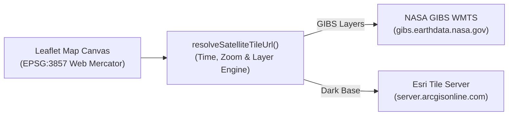

# NASA Satellite Imagery Integration Guide
## Official Remote Sensing Layers & GIBS Architecture

This document details the architecture, service configurations, and scientific constraints governing satellite imagery in TerraTwin.

---

## 1. Remote Sensing Service Architecture

TerraTwin integrates remote-sensing browse products directly from official space agency Web Map Tile Service (WMTS) endpoints:
- **NASA Global Imagery Browse Services (GIBS)**: Managed by the NASA Earth Science Data and Information System (ESDIS) project.
- **Esri World Cartography Services**: Official high-contrast dark canvas base maps.



---

## 2. Integrated Imagery Products

| Layer Identifier | Formal Dataset Name | Native Resolution | Native Zoom Limit | Sensor Platform | Temporal Cadence |
| :--- | :--- | :--- | :--- | :--- | :--- |
| `dark-base` | Esri World Dark Gray Canvas | Cartographic vector/raster | Level 16 | Esri / HERE | Static reference |
| `modis-true-color` | `MODIS_Terra_CorrectedReflectance_TrueColor` | $250\text{ m}$ | Level 9 | MODIS / Terra | Daily browse |
| `modis-ndvi` | `MODIS_Terra_L3_NDVI_16Day` | $250\text{–}500\text{ m}$ | Level 9 | MODIS / Terra | 16-day composite |
| `modis-lst-day` | `MODIS_Terra_Land_Surface_Temp_Day` | $1\text{ km}$ | Level 7 | MODIS / Terra | Daily browse |
| `modis-bands721` | `MODIS_Terra_CorrectedReflectance_Bands721` | $250\text{–}500\text{ m}$ | Level 9 | MODIS / Terra | Daily browse |
| `aster-gdem-relief` | `ASTER_GDEM_Color_Shaded_Relief` | $30\text{ m}$ | Level 12 | ASTER / Terra (METI/NASA) | Static DEM |

---

## 3. WMTS Tile Endpoint Formats

### NASA GIBS EPSG:3857 URL Pattern
```
https://gibs.earthdata.nasa.gov/wmts/epsg3857/best/{Layer}/default/{Time}/{TileMatrixSet}/{z}/{y}/{x}.{format}
```
Example live call for MODIS True Color:
```
https://gibs.earthdata.nasa.gov/wmts/epsg3857/best/MODIS_Terra_CorrectedReflectance_TrueColor/default/2024-07-15/GoogleMapsCompatible_Level9/4/6/9.jpg
```

### Tile Matrix Sets
- `GoogleMapsCompatible_Level7`: For $1\text{ km}$ products (`MODIS_Terra_Land_Surface_Temp_Day`).
- `GoogleMapsCompatible_Level9`: For $250\text{ m}$ products (`MODIS_Terra_CorrectedReflectance_TrueColor`, `MODIS_Terra_L3_NDVI_16Day`, `MODIS_Terra_CorrectedReflectance_Bands721`).
- `GoogleMapsCompatible_Level12`: For $30\text{ m}$ topography (`ASTER_GDEM_Color_Shaded_Relief`).

---

## 4. Zoom Level Clamping & Native Resolution Handling

In Web Mercator (EPSG:3857), requesting tiles beyond a layer's maximum resolution level results in HTTP 400 Bad Request or HTTP 404 Not Found from GIBS servers.

To ensure responsive user zooming up to level 16 without HTTP errors:
1. `maxNativeZoom` is strictly set on Leaflet `TileLayer` instances to the native resolution level (e.g. `maxNativeZoom: 7` for Land Surface Temperature, `maxNativeZoom: 9` for True Color).
2. Leaflet automatically scales and interpolates lower-resolution cached tiles when the user zooms into candidate locations at zoom levels 10–16.

---

## 5. Temporal Handling & Seasonal Presets

### Date Alignment Rules
- **Daily Layers**: Require ISO 8601 `YYYY-MM-DD` strings.
- **16-Day Composites (NDVI)**: Snapped to valid MODIS 16-day compositing periods to prevent missing browse tile errors.
- **Static Products (ASTER GDEM, Esri)**: Omit temporal query parameters (`default/GoogleMapsCompatible_Level12`).

### Seasonal Presets
Four orbital presets allow instant observation comparison across seasons:
- **Boreal Summer** (`2024-07-15`): Maximum vegetation and snowmelt in Northern Hemisphere analogs (Haughton Crater, Svalbard, Askja).
- **Austral Summer** (`2024-01-15`): Optimal solar elevation and low snow cover for Southern Hemisphere sites (McMurdo Dry Valleys, Atacama Desert).
- **Spring Equinox** (`2024-03-21`): Globally balanced day/night cycle.
- **Autumn Equinox** (`2024-09-22`): Late-season vegetative maturity and soil moisture minimums.

---

## 6. Scientific Separation Rule: Browse Products vs. Calibrated Science

> [!IMPORTANT]
> **NASA GIBS tiles are rendered browse products.**
> 
> Colors, pixel intensities, and False-Color contrasts are visualization artifacts intended for qualitative visual exploration. They are **not raw calibrated scientific measurements**.
> 
> - All quantitative similarity scores in TerraTwin derive strictly from verified Level-3/Level-4 scientific datasets (NASA POWER, MOLA MEGDR, LOLA LDEM, Copernicus DEM).
> - Browse imagery is presented as visual context for terrain geomorphology, drainage patterns, and vegetation overprint.

---

## 7. Interactive Map Parameter Overlays

In addition to base satellite imagery, TerraTwin provides **9 interactive parameter telemetry layers**:
1. `similarity`: Overall match fidelity score ($0\text{–}100\%$)
2. `elevation`: Elevation relative to geoid ($\text{m}$)
3. `slope`: Terrain slope gradient ($^\circ$)
4. `rock`: Surface rock abundance ($\%$)
5. `grain`: Median regolith particle size ($\text{mm}$)
6. `temp`: Mean surface skin temperature ($^\circ\text{C}$)
7. `albedo`: Broadband visible reflectance ($0\text{–}1$)
8. `solar`: Incident downward solar flux ($\text{W/m}^2$)
9. `vegetation`: Fractional botanical ground cover ($\%$)

Telemetry values render as high-contrast badges floating over candidate markers, updating dynamically as different parameters are selected.
