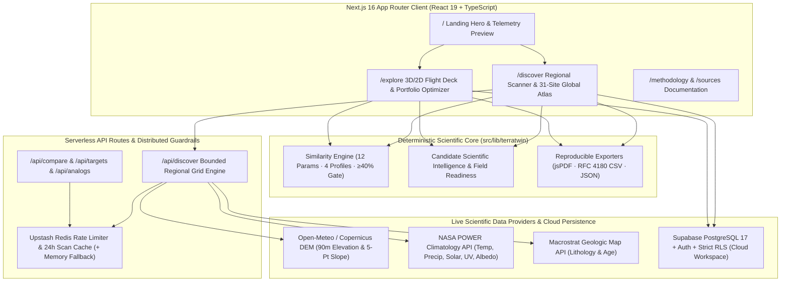

# TerraTwin — Planetary & Terrestrial Analog Intelligence Engine

> **Deterministic Multi-Parameter Similarity Modeling, Bounded Live Regional Screening, 31-Site Global Discovery Atlas, and Reproducible Research Workflows for Lunar & Martian Mission Preparation.**  
> **Team:** HEXARCHY (Six Members) | **Event:** NASA International Space Apps Challenge

---

## 1. Project Title & Tagline

**TerraTwin** — *Connecting planetary mission objectives to Earth analog discovery, scientific evidence coverage, and reproducible field-readiness workflows while explicitly quantifying uncertainty.*

---

## 2. Official Challenge Statement

> **"Identify Earth Locations that Analog the Permanent Moon Base Locations and Mars."**

---

## 3. Why Earth Analogs Matter

Before a rover lands in **Jezero Crater Delta**, a drill cores **Gale Crater** clay-sulfates, or an Artemis crew constructs an ISRU habitat on the **Shackleton Crater Rim**, hardware and operational protocols must be tested on Earth. However:

1. **No single place on Earth duplicates the Moon or Mars.** A site that matches basaltic slope and regolith mechanics for rover mobility may be completely wrong for carbonate astrobiology or polar volatile extraction.
2. **Analog selection is traditionally fragmented.** Researchers cross-reference scattered literature, geological maps, and climate tables without a unified, reproducible mathematical framework.
3. **Missing data is often hidden behind opaque scores.** When a remote region lacks public bedrock or grain-size measurements, naive scoring tools silently impute defaults or inflate confidence.

---

## 4. What TerraTwin Does

TerraTwin transforms terrestrial analog selection from static literature lookup into an **evidence-gated scientific decision workflow**:

1. **Mission-Dependent Similarity Modeling:** Evaluates candidate Earth sites against **5 verified Lunar and Martian targets** across **12 environmental parameters** using **4 configurable mission weight vectors**.
2. **Dual-Scale Discovery:** Combines **8 canonical benchmark sites** (`/explore`), a **31-site Global Discovery Atlas** across **18 countries/territories** and **9 analog categories** (`/discover`), and a **Live Regional Discovery Engine** (`/api/discover`) that screens bounded WGS84 regions using live **Open-Meteo / Copernicus DEM**, **NASA POWER climatology**, and **Macrostrat geology**.
3. **Strict Epistemic Honesty (The ≥40% Evidence Gate):** Preserves `null` for unavailable observations,withholds composite similarity scores whenever weighted data coverage falls below **`40%` (`0.40`)**, and labels every live grid cell `isVerified: false` (*Exploratory Grid Candidate*).
4. **Multi-Site Portfolio Optimization:** Identifies 2-site terrestrial testbed combinations where complementary strengths maximize coverage of mission-weighted parameters (e.g., **Atacama Desert + Haughton Impact Structure = `90.3%`** for Gale Crater rover testing).
5. **Reproducible Research Workspace & Exports:** Captures immutable, SHA-like FNV-1a integrity-digested research snapshots (`schemaVersion: "1.0.0"`), syncs across authenticated sessions via **Supabase PostgreSQL 17 Row-Level Security (RLS)** with offline `localStorage` fallback, and exports structured **PDF**, **CSV**, and **JSON** dossiers.

---

## 5. Key Capabilities

| Capability | Route / Module | Scientific & Engineering Highlights |
|---|---|---|
| **3D/2D Planetary Flight Deck** | `/explore` | Interactive Three.js Moon/Mars globe with automatic WebGL fallback to a 2D Equirectangular Telemetry Grid, synchronized with a dark-canvas Leaflet Earth map and Recharts radar comparison. |
| **Multi-Site Portfolio Optimizer** | `/explore` (`Mission Suite`) | Evaluates 2-site terrestrial combinations using parameter-wise maximum coverage (`max(sim_A, sim_B)`) to quantify multi-site synergy gains. |
| **Live Regional Discovery Scanner** | `/discover` (`/api/discover`) | Generates bounded WGS84 grid cells (`<= 16` cells, `<= 6° × 6°`, `>= 0.25°` spacing), queries live providers concurrently, and enforces the `40%` reliable coverage gate. |
| **31-Site Global Discovery Atlas** | `/discover` (`Global Atlas` tab) | Ranks `8` canonical benchmarks + `23` under-explored global analog candidates across `18` countries/territories and `9` categories, with a *"Scan Region Around Site"* action. |
| **Candidate Scientific Intelligence** | `/discover` (Detail Drawer) | Generates deterministic primary drivers, limiting mismatches, missing high-weight evidence alerts (`weight >= 0.05`), and actionable field validation plans. |
| **Reproducible Research Workspace** | `/explore` & `/discover` | Stores immutable assessment revisions (`research_assessment_revisions`), tasks, notes, verification checklists, and exports reproducible `PDF`, `CSV`, and `JSON` reports. |
| **Distributed API Reliability** | `/api/discover`, `/api/compare` | Uses **Upstash Redis** REST sliding-window rate limiting (`12 req/min` on `/api/discover`, `60 req/min` on `/api/compare`) and normalized 24-hour scan caching with automatic in-memory fallback. |

---

## 6. Live Demo Instructions (3-Scenario Judge Walkthrough)

Start the server (`npm run dev` or `npm run build && npm run start`) and open `http://localhost:3000`, or use the **Judge Demo Scenarios (Quick Load)** bar at the top of `/discover`:

1. **Scenario A — Mars Jezero Delta & Honest Live Regional Gate (`/discover`):**
   - Click **Demo A1 · Live Gate** (`Mars Jezero · Lake Salda` under `geological-research`, bbox `[37.10, 29.20, 37.90, 30.10]`, `2×2` grid) and click **Launch Regional Scan**.
   - Inspect why the engine returns **`15%` coverage (`0.15 < 0.40`)** and **withholds the similarity score** (`score: null` — Macrostrat returns `"Pliocene undifferentiated"` outside the U.S., so `lithology` (`0.30`) and `mineralogy` (`0.25`) remain `null`).
   - Now click **Demo A2 · Live Scored** (switches to `rover-testing` on the exact same `2×2` bbox) and click **Launch Regional Scan**. Watch coverage rise to **`45%` (`0.45 >= 0.40`)** (`slope 0.25 + elevation 0.10 + diurnal 0.05 + mean temp 0.05`) and compute a **`65.0%` exploratory similarity score** (`isVerified: false`).
2. **Scenario B — Lunar South Pole ISRU & Portfolio Synergy (`/discover` & `/explore`):**
   - Click **Demo B · Lunar ISRU** (`Moon` → `Shackleton Crater Rim`, `lunar-base-construction`). Inspect **McMurdo Dry Valleys (`66.5%`, `100%` coverage)** and why no open-air Earth site exceeds ~`67%` against a `-183°C` vacuum crater rim.
   - Switch to `/explore`, select **Mars → Gale Crater** under `rover-testing`, and open the **Analog Portfolio** tab to inspect how **Atacama Desert (`80.6%`) + Haughton Impact Structure (`79.5%`)** combine for a **`90.3%` two-site portfolio score (`+9.7%` synergy gain)**.
3. **Scenario C — 31-Site Global Discovery Atlas & Reproducible Exports (`/discover`):**
   - Click **Demo C · Global Atlas** (`Mars` → `Jezero Crater Delta`, `geological-research`). Inspect #1 **Tibetan Plateau — Qinghai (`92.3%`, `Under-Explored Candidate`)**, save a Research Assessment snapshot, and export the **PDF**, **CSV**, and **JSON** dossiers.

---

## 7. 31-Site Global Discovery Atlas Overview

The curated Global Discovery Atlas (`src/lib/terratwin/data/global-discovery-atlas.ts`) contains **31 terrestrial analog sites** across **18 countries/territories** (`Antarctica`, `Argentina`, `Australia`, `Bolivia`, `Canada`, `Chile`, `China`, `Ethiopia`, `Germany`, `Greenland`, `Iceland`, `India`, `Libya`, `Norway`, `Oman`, `Spain`, `Turkey`, `United States`):

- **8 Canonical Benchmarks (`canonical-benchmark`):** Atacama Desert (Chile), McMurdo Dry Valleys (Antarctica), Rio Tinto Basin (Spain), Lake Salda (Turkey), Haughton Impact Structure (Canada), Channeled Scablands (USA), Askja Caldera & Holuhraun Lava Field (Iceland), Craters of the Moon National Monument (USA).
- **23 Under-Explored Candidates (`under-explored-candidate`):** Spanning **9 analog categories**:
  - `salt-flats-evaporites` (`4` sites)
  - `polar-permafrost` (`3` sites)
  - `volcanic-fields` (`4` sites)
  - `impact-craters` (`4` sites)
  - `high-altitude-plateaus` (`3` sites)
  - `glacial-outwash` (`3` sites)
  - `lava-tubes-caves` (`3` sites)
  - `dry-river-deltas` (`3` sites)
  - `serpentinizing-acidic-mineral-systems` (`4` sites)

> **Important Distinction:** These 31 sites are literature-curated terrestrial sites with documented coordinates and citations — they are **not** claimed to be automatically discovered by an unconstrained global live-grid sweep.

---

## 8. Live Regional Discovery Overview

The Live Regional Discovery Scanner (`src/lib/terratwin/services/discovery-engine.ts`) performs bounded, on-demand regional screening:
- **Guardrails:** Enforces `MAX_CELLS = 16`, `MAX_LAT_SPAN_DEG = 6.0`, `MAX_LON_SPAN_DEG = 6.0`, and `MIN_GRID_SPACING_DEG = 0.25` to prevent upstream API abuse.
- **5-Point Stencil Slope Derivation:** Samples elevation at `(lat, lon)` and `±0.01°` cardinal offsets via Open-Meteo / Copernicus DEM (`90 m`) and computes local topographic slope via central finite differences:
  $$\text{slope}_{\text{deg}} = \arctan\left(\sqrt{\left(\frac{\Delta z_{\text{NS}}}{2 \cdot \Delta y}\right)^2 + \left(\frac{\Delta z_{\text{EW}}}{2 \cdot \Delta x}\right)^2}\right) \cdot \frac{180}{\pi}$$
- **Climatology & Geology Enrichment:** Queries NASA POWER (`T2M`, `T2M_RANGE`, `PRECTOTCORR`, `ALLSKY_SFC_SW_DWN`, `ALLSKY_SFC_UV_INDEX`, `SRF_ALB`) and Macrostrat (`/api/v2/geologic_units/map`). Unmapped or generic descriptions (`"undifferentiated"`) are strictly set to `null`.

---

## 9. Planetary Target & Mission Profile Overview

### 5 Planetary Targets
- **Mars:** `Jezero Crater Delta` (`18.38°N, 77.58°E`), `Gale Crater` (`5.40°S, 137.80°E`), `Valles Marineris — Coprates Chasma` (`13.90°S, 60.50°W` — *Partial reference dataset*).
- **Moon:** `Shackleton Crater Rim` (`89.90°S, 0.00°E`), `Mare Tranquillitatis` (`0.67°N, 23.47°E`).

### 4 Configurable Mission Profiles (`src/lib/terratwin/config/comparison-config.ts`)

| Parameter | Rover Testing (`rover-testing`) | Geological Research (`geological-research`) | Lunar Base & ISRU (`lunar-base-construction`) | Astrobiology (`astrobiology-habitability`) |
|---|---|---|---|---|
| `slopeDeg` | **0.25** | 0.08 | **0.22** | 0.02 |
| `rockAbundancePct` | **0.20** | 0.05 | **0.16** | 0.00 |
| `grainSizeMm` | **0.15** | 0.07 | **0.15** | 0.03 |
| `elevationM` | 0.10 | 0.05 | 0.05 | 0.00 |
| `albedo` | 0.05 | 0.05 | 0.05 | 0.00 |
| `meanTempC` | 0.05 | 0.05 | 0.05 | 0.10 |
| `diurnalTempRangeC` | 0.05 | 0.05 | **0.15** | 0.05 |
| `annualPrecipMm` | 0.05 | 0.05 | 0.02 | **0.15** |
| `lithology` | 0.05 | **0.30** | 0.05 | **0.15** |
| `mineralogy` | 0.05 | **0.25** | 0.10 | **0.25** |
| `waterIceRegime` | 0.00 | 0.00 | 0.00 | **0.15** |
| `radiationRegime` | 0.00 | 0.00 | 0.00 | 0.10 |

---

## 10. Scientific Similarity Methodology & 40% Coverage Gate

For a planetary target $T$, terrestrial candidate $A$, and mission profile $M$ with weights $w_i \ge 0$ ($\sum_{i=1}^{12} w_i = 1.0$):

1. **Per-Feature Normalization ($s_i \in [0, 1]$):**
   - **Linear Tolerance:** $s_i = \max\left(0, 1 - \frac{|x_{T,i} - x_{A,i}|}{\tau_i}\right)$ (`meanTempC`, `diurnalTempRangeC`, `elevationM`, `slopeDeg`, `rockAbundancePct`, `albedo`).
   - **Logarithmic Tolerance:** $s_i = \max\left(0, 1 - \frac{|\log_{10}(\max(x_{T,i}, \epsilon)) - \log_{10}(\max(x_{A,i}, \epsilon))|}{\tau_{\log,i}}\right)$ (`annualPrecipMm`, `grainSizeMm`).
   - **Symmetric Categorical Matrix:** $s_i = \mathbf{C}_i(c_{T,i}, c_{A,i}) \in [0, 1]$ (`lithology`, `mineralogy`, `waterIceRegime`, `radiationRegime`).
2. **Evidence Coverage Ratio ($C$):**
   $$C = \frac{\sum_{i \in V} w_i}{\sum_{i=1}^{12} w_i}$$
   where $V$ is the subset of mission-weighted parameters ($w_i > 0$) where **both** $x_{T,i}$ and $x_{A,i}$ are non-`null`.
3. **The 40% Reliable Coverage Gate (`MIN_RELIABLE_COVERAGE_RATIO = 0.40`):**
   - If $C < 0.40$, TerraTwin sets `isReliable = false` and **withholds the similarity score (`score = null`)**.
   - If $C \ge 0.40$, TerraTwin sets `isReliable = true` and computes:
     $$\text{Score} = \text{round}\left(100 \times \frac{\sum_{i \in V} w_i \cdot s_i}{\sum_{i \in V} w_i},\ 1\right)$$

---

## 11. Candidate Intelligence & Research Workspace Overview

- **Candidate Scientific Intelligence (`src/lib/terratwin/intelligence/candidate-intelligence.ts`):** Deterministically inspects each candidate's feature vector to identify **Primary Drivers**, **Key Mismatches**, **Missing High-Weight Evidence** (`w_i >= 0.05`), and **Field Validation Priorities** (`critical` vs. `recommended`).
- **Cloud & Local Research Workspace (`src/hooks/use-cloud-research-workspace.ts`):**
  - Every saved assessment creates an immutable snapshot (`schemaVersion: "1.0.0"`) with an FNV-1a integrity digest (`fnv1a-xxxxxxxx`).
  - When signed in via **Supabase Auth**, records sync to PostgreSQL 17 tables (`research_records`, `research_assessment_revisions`, `research_tasks`, `research_notes`) protected by strict `auth.uid() = user_id` **Row-Level Security (RLS)** and a database trigger (`prevent_revision_mutation_trigger`) that rejects `UPDATE`/`DELETE` on historical revisions.
  - When offline or unauthenticated, records persist seamlessly in browser `localStorage` with explicit 1-click cloud import (`importLocalRecordsToCloud`) that deduplicates revisions by `revisionId` and `integrityDigest`.

---

## 12. PDF, CSV, and JSON Export Capabilities

Implemented in `src/lib/terratwin/reporting/research-exporters.ts`:
- **Structured PDF Report (`.pdf`):** Multi-section vector PDF via `jsPDF` containing executive summary, provenance & integrity metadata (`schemaVersion`, `integrityDigest`, `isVerified`), parameter-by-parameter comparison table, and field validation checklist.
- **RFC 4180 CSV Table (`.csv`):** Spreadsheet-ready export of all 12 parameters (`target_value`, `candidate_value`, `normalized_similarity_pct`, `mission_weight_pct`, `status`, `is_verified`, `source`) with UTF-8 BOM and formula-injection sanitization (`=`, `+`, `-`, `@` prefixed with `'`).
- **Schema-Versioned JSON Package (`.json`):** Full machine-readable research bundle (`exportFormat: "terratwin-research-package"`, `schemaVersion: "1.0.0"`) for programmatic reproducibility.

---

## 13. System Architecture Diagram



---

## 14. NASA and Partner Data Sources

| Source | Provider / Agency | Parameters Supplied | Integration Mode |
|---|---|---|---|
| **NASA PDS / MRO / Perseverance / Curiosity** | NASA Planetary Data System | Martian target reference vectors (`Jezero Delta`, `Gale Crater`, `Coprates Chasma`) | Curated Reference Baseline (`seed-data.ts`) |
| **NASA LRO (LOLA / Diviner) & Apollo** | NASA GSFC / PDS | Lunar target reference vectors (`Shackleton Rim`, `Mare Tranquillitatis`) | Curated Reference Baseline (`seed-data.ts`) |
| **NASA POWER API** | NASA Langley Research Center | `meanTempC` (`T2M`), `diurnalTempRangeC` (`T2M_RANGE`), `annualPrecipMm` (`PRECTOTCORR`), `albedo` (`SRF_ALB`), Solar/UV | Live HTTP API (`nasa-power.ts`) + Curated Baseline |
| **Copernicus DEM (GLO-90) via Open-Meteo** | ESA Copernicus / Open-Meteo | `elevationM` and 5-point stencil `slopeDeg` | Live HTTP API (`open-meteo.ts`) + Curated Baseline |
| **Macrostrat API v2** | UW–Madison / NSF | Bedrock `lithology`, geologic age, and rock type | Live HTTP API (`macrostrat.ts`) + Curated Baseline |
| **ASTER GDEM / HiRISE / Peer-Reviewed Field Studies** | NASA JPL / USGS / Academic Literature | `rockAbundancePct`, `grainSizeMm`, `mineralogy`, `waterIceRegime` for canonical & Atlas sites | Curated Literature Citations (`global-discovery-atlas.ts`) |

---

## 15. Data Provenance & Scientific Limitations

1. **Global Satellite APIs Cannot Measure Sub-Meter Field Parameters:** Live regional scans (`/api/discover`) cannot observe surface `rockAbundancePct`, regolith `grainSizeMm`, or subsurface `waterIceRegime`. Those parameters remain `null` (`0%` coverage contribution) until verified by field sampling or drone photogrammetry.
2. **Macrostrat Geographic Coverage:** Macrostrat provides detailed lithology primarily in North America and select regions; outside those regions (e.g., Lake Salda, Turkey), undifferentiated units are mapped to `null` rather than guessed.
3. **Earth's Atmosphere & Gravity (1 bar, 1 $g$):** No open-air terrestrial site replicates the lunar hard vacuum (`3×10⁻¹⁵ bar`), `0.165 g` lunar gravity, `0.38 g` Martian gravity, or unshielded galactic cosmic radiation.

---

## 16. Local Setup & Environment Variables

```bash
# 1. Install dependencies
npm install

# 2. Configure environment variables (.env.local)
# TerraTwin runs out-of-the-box with zero required keys (using curated seed fallbacks,
# live keyless NASA POWER / Open-Meteo / Macrostrat APIs, in-memory rate limiting,
# and localStorage persistence). Optional cloud services:
NEXT_PUBLIC_SUPABASE_URL="https://<your-project>.supabase.co"
NEXT_PUBLIC_SUPABASE_ANON_KEY="<your-supabase-anon-key>"
UPSTASH_REDIS_REST_URL="https://<your-upstash-endpoint>.upstash.io"
UPSTASH_REDIS_REST_TOKEN="<your-upstash-rest-token>"

# 3. Start development server
npm run dev
```

> **Security Rule:** Never expose `SUPABASE_SERVICE_ROLE_KEY` or `UPSTASH_REDIS_REST_TOKEN` via `NEXT_PUBLIC_*` client variables.

---

## 17. Verification & Test Commands

```bash
# TypeScript & ESLint verification
npx tsc --noEmit
npm run lint

# Production build verification
npm run build

# Scientific & regression test suites
npx tsx scripts/test-phase3-master.mjs
npx tsx scripts/test-phase4-master.mjs
npx tsx scripts/test-phase6-step1-types-and-profiles.mjs
npx tsx scripts/test-phase6-step2-discovery-atlas.mjs
npx tsx scripts/test-phase6-step3-live-discovery.mjs
npx tsx scripts/test-phase6-step3-1-hardening.mjs
npx tsx scripts/test-phase6-step5-scientific-intelligence.mjs
npx tsx scripts/test-phase6-step6-reports-and-workflow.mjs
npx tsx scripts/test-phase6-step7-final-integration.mjs
npx tsx scripts/test-distributed-redis-reliability.mjs
npx tsx scripts/test-cloud-research-workspace.mjs
```

---

## 18. Browser E2E Testing Summary

With the server running on `http://127.0.0.1:3000`, run the headless Chrome DevTools Protocol (CDP) E2E suites:

```bash
npx tsx tests/e2e/discovery-scanner.spec.ts
npx tsx tests/e2e/scientific-intelligence.spec.ts
npx tsx tests/e2e/research-reports-workflow.spec.ts
npx tsx tests/e2e/phase6-final-acceptance.spec.ts
npx tsx tests/e2e/phase7-demo-readiness.spec.ts
```

Screenshots and visual verification artifacts are saved in `artifacts/phase6/` and `artifacts/phase7/`.

---

## 19. Deployment Notes

TerraTwin is ready for zero-configuration deployment on **Vercel** (`npm run build` compiles cleanly with Next.js 16 App Router):
- Add `NEXT_PUBLIC_SUPABASE_URL`, `NEXT_PUBLIC_SUPABASE_ANON_KEY`, `UPSTASH_REDIS_REST_URL`, and `UPSTASH_REDIS_REST_TOKEN` in the Vercel project environment settings if cloud persistence and distributed rate limiting are desired.
- If omitted, TerraTwin automatically falls back to in-memory rate limiting and browser `localStorage` research persistence without runtime errors.

---

## 20. Team HEXARCHY (Six Members)

| Role | Member Name | Primary Focus & Q&A Domain |
|---|---|---|
| **Member 1 — Team Lead & Lead Developer** | *[Insert Lead Developer Name]* | Full-Stack Next.js Architecture, Similarity Engine, API Guardrails, Cloud RLS |
| **Member 2 — Planetary Science & Mission Lead** | *[Insert Member 2 Name]* | Lunar & Martian Reference Targets, 4 Mission Profiles, Portfolio Synergy |
| **Member 3 — Geospatial & Live Data Lead** | *[Insert Member 3 Name]* | `/discover` Live Regional Scanner, Open-Meteo 5-Pt DEM Slope, NASA POWER, Macrostrat |
| **Member 4 — Global Atlas & Provenance Lead** | *[Insert Member 4 Name]* | 31-Site Global Discovery Atlas, 18 Countries, 9 Categories, Scientific Citations |
| **Member 5 — UI/UX & Visualization Lead** | *[Insert Member 5 Name]* | 3D/2D Planetary Globe, Dark-Canvas Leaflet Maps, Radar Charts, Responsive UX |
| **Member 6 — Research Workflow & QA Lead** | *[Insert Member 6 Name]* | Candidate Intelligence, Immutable Research Snapshots, PDF/CSV/JSON Exports, E2E QA |

---

## 21. AI-Assisted Development Disclosure

In accordance with NASA International Space Apps Challenge transparency guidelines:
- Generative AI coding assistants were used during development to accelerate TypeScript scaffolding, UI component structuring, automated E2E test authoring, and technical documentation formatting.
- All scientific tolerance equations, mission weight vectors, 40% coverage gating rules, data provider integrations (`Open-Meteo`, `NASA POWER`, `Macrostrat`), and similarity outputs were deterministically verified against real scientific datasets and automated regression suites. No scientific measurements or scan scores are generated by AI models.

---

## 22. License & Attribution

- **Source Code License:** MIT License.
- **Data Attribution:** Planetary and terrestrial datasets courtesy of **NASA Planetary Data System (PDS)**, **NASA Langley Research Center POWER Project**, **ESA Copernicus DEM via Open-Meteo**, and **UW–Madison Macrostrat** (CC-BY 4.0). TerraTwin is an independent hackathon research project and does not claim official NASA endorsement.
