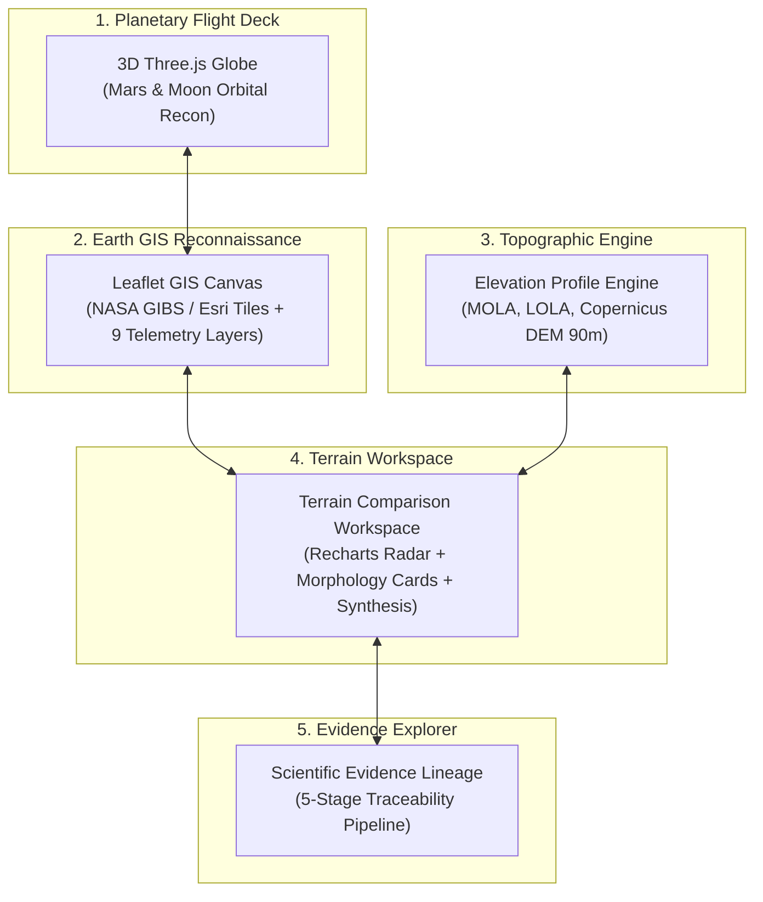

# TerraTwin Scientific Visualization Guide
## Advanced Planetary Analog Research Platform // Phase 4 Architecture

This document provides a comprehensive technical reference for the scientific visualization instruments integrated into TerraTwin during **Phase 4: Advanced Scientific Visualization & Planetary Data Explorer**.

---

## 1. Executive Architecture Overview

TerraTwin transforms planetary exploration data from NASA, ESA, and international geological surveys into an interactive, high-fidelity research platform. Rather than displaying isolated numbers or decorative graphs, TerraTwin synchronizes **multi-dimensional remote-sensing telemetry** across the Moon, Mars, and Earth through five unified scientific visualization subsystems:

---

## 2. Core Visualization Subsystems

### A. 3D Planetary Mission Control Flight Deck
- **Technology**: Three.js WebGL canvas rendered via React client component boundaries (`src/components/explorer/planetary-globe.tsx`, `planetary-globe-canvas.tsx`).
- **Spherical Reference Datums**:
  - **Mars**: IAU2000 Areoid radial model with Viking/MOLA global albedo texture mapping.
  - **Moon**: Lunar Reference Sphere ($R = 1,737.4\text{ km}$) with LRO WAC global mosaic.
- **Interactivity**: Dynamic raycasting on target landing site markers, smooth orbital slerp camera transitions, subsolar point lighting, and coordinate readout in decimal and degree-minute-second formats.

### B. Earth Analog GIS Reconnaissance Map
- **Technology**: React Leaflet with custom EPSG:3857 tile layers and SVG data-driven telemetry overlays (`src/components/explorer/analog-map.tsx`, `analog-map-canvas.tsx`).
- **Satellite Imagery Layers**:
  1. `dark-base`: Esri World Dark Gray Canvas (reference baseline).
  2. `modis-true-color`: NASA GIBS MODIS Terra Corrected Reflectance True Color ($250\text{ m}$).
  3. `modis-ndvi`: NASA GIBS MODIS Terra L3 16-Day NDVI ($250\text{–}500\text{ m}$).
  4. `modis-lst-day`: NASA GIBS MODIS Terra Day Land Surface Temperature ($1\text{ km}$).
  5. `modis-bands721`: NASA GIBS MODIS Terra SWIR Bands 7-2-1 ($250\text{–}500\text{ m}$).
  6. `aster-gdem-relief`: NASA/METI ASTER Global DEM Color Shaded Relief ($30\text{ m}$).
- **Interactive Map Layers**: 9 calibrated parameter overlays displaying live numeric values directly on analog markers (Fidelity Score, Elevation, Slope, Rock Abundance, Grain Size, Surface Temp, Albedo, Solar Flux, Vegetation).
- **Seasonal Presets**: Instant calendar alignment to Boreal/Austral Summer and Equinoxes.

### C. Topographic Elevation Profile & Relief Engine
- **Technology**: Recharts `AreaChart`, geodesic slerp sampling, and binary MOLA/LOLA raster interpolation (`src/lib/terratwin/elevation.ts`, `src/components/explorer/elevation-profile-panel.tsx`).
- **Sampling Resolutions**: Configurable transect sampling density ($N = 20, 35, 50$ points).
- **Physical Datums**:
  - Mars: MOLA GMM-3 equipotential areoid ($610.5\text{ Pa}$).
  - Moon: LOLA LDEM spherical datum ($R = 1,737.4\text{ km}$).
  - Earth: EGM96 Geoid / Mean Sea Level (Copernicus DEM 90m `COP-DEM-GLO-90`).
- **Datum Isolation Modes**:
  - **Relative Relief ($\Delta z$)**: $\Delta z_i = z_i - z_0$ isolates local topography, enabling direct comparison of crater walls, delta fans, and volcanic calderas.
  - **Dual Y-Axis**: Preserves raw absolute elevation while isolating planetary datums on independent vertical scales.
  - **Split Twin View**: Side-by-side synchronized charts preventing visual cross-contamination.

### D. Advanced Terrain Comparison Workspace
- **Technology**: Multi-axis Recharts `RadarChart`, side-by-side morphology cards, categorized parameter matrix, and automated synthesis (`src/components/explorer/terrain-comparison-workspace.tsx`).
- **Panels**:
  - **Panel A**: Planetary Target Panel (world badge, mission context, coordinates, summary).
  - **Panel B**: Earth Analog Selection Panel (8 vetted candidate sites with quick-switch).
  - **Panel C**: Side-by-side visualizations:
    - 6-axis Radar Chart (Slope, Rock, Grain Size [log], Albedo, Temp, Solar Flux).
    - Physical Morphology Cards (Slope kinematics, boulder hazard, Wentworth sediment scale, Lithology family match).
  - **Panel D**: Domain-categorized parameter comparison matrix (5 scientific domains).
  - **Panel E**: Feature-level similarity breakdown with dynamic mission purpose weights ($D = \sum w_i d_i / \sum w_i$).
  - **Panel F**: Scientific dataset provenance & limitation citations.
  - **Panel G**: Data-driven scientific interpretation panel synthesizing rover mobility, thermal extremes, petrological fidelity, and mission suitability verdicts.

### E. Scientific Evidence Explorer
- **Technology**: 5-stage interactive lineage inspection panel (`src/components/explorer/scientific-evidence-explorer.tsx`, `src/lib/terratwin/evidence-lineage.ts`).
- **Traceability Flow**:
  $$\text{Location} \longrightarrow \text{Parameter} \longrightarrow \text{Measurement} \longrightarrow \text{Instrument / Dataset} \longrightarrow \text{Official Documentation}$$
- **Authentic Attribution**: Direct links to NASA PDS Geosciences, NASA Earthdata, LP DAAC, and Copernicus ESA repositories. Zero synthetic citations.

---

## 3. Scientific Data Integrity Rules

1. **Zero Fabricated Profiles**: Elevation transects are never generated from a single point elevation. Extraterrestrial profiles use authentic geodesic sampling of MGS MOLA MEGDR and LRO LOLA LDEM data; Earth profiles use authentic 30-point Copernicus DEM 90m data.
2. **Browse Product Separation**: NASA GIBS imagery tiles are treated strictly as qualitative browse products. All similarity scoring and quantitative metrics use calibrated Phase 3 datasets.
3. **Strict Datum Isolation**: Because planetary reference surfaces differ fundamentally (equipotential areoid vs reference sphere vs geoid), values are never overlaid on a single vertical axis without a justified mathematical transformation (Relative Relief $\Delta z$).
4. **Physical Disparity Enforcement**: Atmospheric pressure ($10^{-10}\text{ Pa}$ Moon vs $700\text{ Pa}$ Mars vs $101.3\text{ kPa}$ Earth) and liquid precipitation ($0\text{ mm/yr}$ targets) are classified as non-comparable and strictly excluded from similarity scoring.

---

## 4. Verification & Testing

Every visual instrument is continuously validated by automated test suites:
- `scripts/test-milestone-b-satellite-layers.mjs` (GIBS WMTS, date resolution, layer configs)
- `scripts/test-milestone-c-elevation.mjs` (MOLA/LOLA sampling, Copernicus DEM, relative relief)
- `scripts/test-milestone-d-terrain.mjs` (Radar normalization, Wentworth scaling, synthesis generation)
- `scripts/test-milestone-e-lineage.mjs` (5-stage lineage, instrument attribution, HTTPS URLs)
- `scripts/test-phase4-master.mjs` (Master Phase 4 aggregator)
