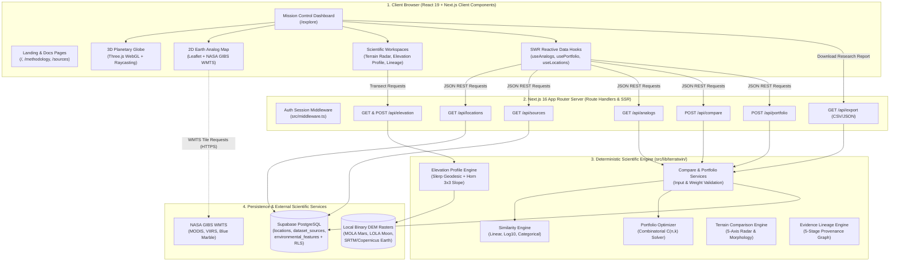
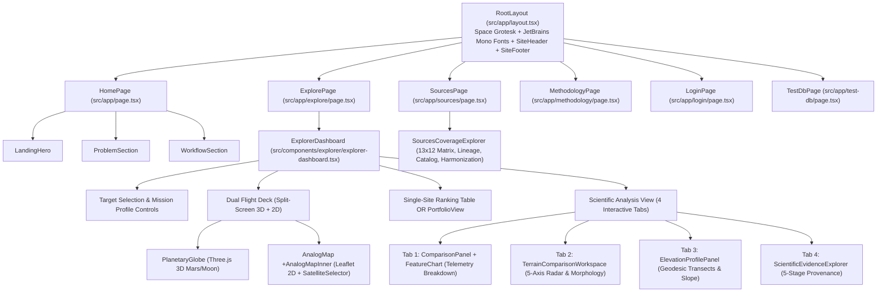
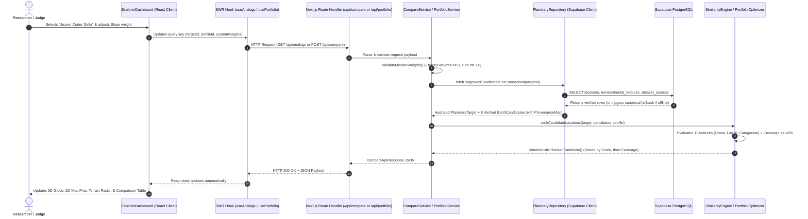
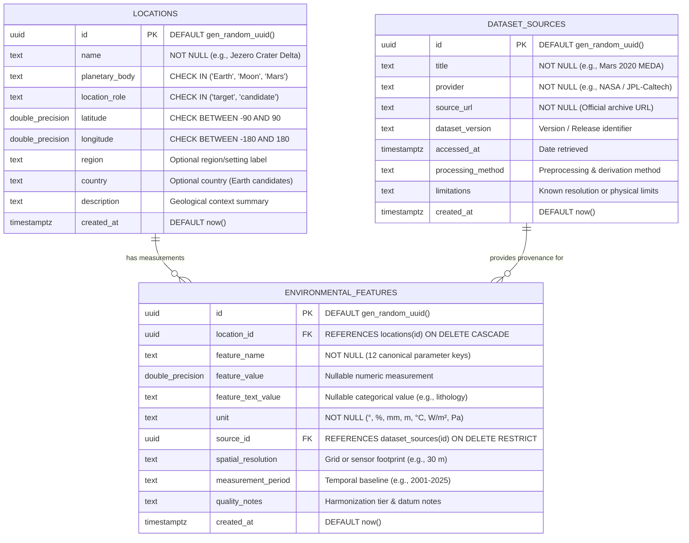

# TerraTwin — Technical Architecture Reference

**Project:** TerraTwin: Planetary Analog Portfolio Optimizer & Mission Control Suite  
**Team:** HEXARCHY (NASA Space Apps Challenge)  
**Architecture Paradigm:** Next.js 16 App Router + TypeScript 5 + Supabase PostgreSQL + Deterministic Scientific Engine + Hybrid 3D WebGL / 2D GIS Visualization

---

## 1. High-Level System Architecture

**What this is (Beginner Explanation):**  
A **System Architecture** is the blueprint showing how all parts of our web application talk to each other. TerraTwin is built using a **four-tier layered architecture**:
1. **Presentation Layer (Frontend UI):** Runs in the user's web browser. Displays the 3D planetary globe, the 2D Earth satellite map, charts, and interactive controls.
2. **Application & API Layer (Next.js Server):** Receives requests from the browser (like *"Find the best Earth analog for Jezero Crater"*), validates the input so bad data cannot crash the server, and coordinates the calculation.
3. **Domain & Scientific Engine Layer (`src/lib/terratwin/`):** Pure TypeScript mathematical modules that compute similarity scores, multi-site portfolios, topographic elevation profiles, and Horn (1981) terrain slopes.
4. **Data & External Telemetry Layer:** Stores and serves verified planetary and terrestrial measurements from **Supabase PostgreSQL**, binary Digital Elevation Model (DEM) rasters (`raw-data/dem/`), and live **NASA GIBS WMTS** satellite imagery tiles.



---

## 2. Frontend Component Hierarchy

**What this is (Beginner Explanation):**  
In React, the user interface is built out of reusable building blocks called **Components**, arranged like a family tree. **Server Components** run on the server first to load the page shell quickly, while **Client Components** (marked with `"use client"` at the top of the file) run in the browser so users can click buttons, drag sliders, and rotate the 3D globe.



### Component Directory Map (`src/components/`)

| Directory / File | Responsibility | Rendering Mode |
| :--- | :--- | :--- |
| `src/components/layout/site-header.tsx` | Top navigation bar, active route highlighting, user auth status badge | Server + Client |
| `src/components/layout/site-footer.tsx` | Scientific disclaimer footer and navigation links | Server Component |
| `src/components/landing/*` | Hero section, problem breakdown, and 3-step workflow cards | Server Component |
| `src/components/explorer/explorer-dashboard.tsx` | Master state controller for `/explore`: coordinates target selection, mission weights, Single vs Portfolio mode, and synchronized views | Client Component |
| `src/components/explorer/planetary-globe.tsx` | Interactive 3D WebGL globe for Mars and Moon using Three.js, custom GLSL atmosphere shader, raycasted target pins, and spherical camera slerp | Client Component |
| `src/components/explorer/analog-map.tsx` | Dynamic SSR-safe wrapper (`next/dynamic` with `ssr: false`) for Leaflet map | Client Component |
| `src/components/explorer/analog-map-inner.tsx` | Interactive 2D Earth GIS map with ranked telemetry pins, custom SVG markers, HUD overlay, and NASA GIBS WMTS tile integration | Client Component |
| `src/components/explorer/satellite-layer-selector.tsx` | Floating remote-sensing control panel for switching 6 base/GIBS layers, adjusting opacity, and picking observation dates | Client Component |
| `src/components/explorer/comparison-panel.tsx` | Parameter-by-parameter comparison table with provenance badges, normalized distances, and dataset hover tooltips | Client Component |
| `src/components/explorer/feature-chart.tsx` | Recharts grouped bar chart comparing normalized similarity across active mission parameters | Client Component |
| `src/components/explorer/terrain-comparison-workspace.tsx` | Phase 4 geomorphological workspace: 5-axis normalized radar chart, morphology regime cards, slope/roughness bar chart, and synthesis engine | Client Component |
| `src/components/explorer/elevation-profile-panel.tsx` | Interactive topographic cross-section profiler with Relative Relief, Normalized `[0,1]`, and Raw Datum modes plus transect direction/length controls | Client Component |
| `src/components/explorer/scientific-evidence-explorer.tsx` | Interactive 5-stage telemetry lineage inspector (`Raw Mission Source -> Measurement -> Harmonization -> Math Role -> UI Output`) | Client Component |
| `src/components/explorer/portfolio-view.tsx` | Multi-Site Portfolio Optimizer UI (Mission Suite) displaying $C(n,k)$ combinations, synergy gain badges, parameter winner attributions, and gap alerts | Client Component |
| `src/components/sources/sources-coverage-explorer.tsx` | Interactive 4-tab scientific verification hub on `/sources` (13×12 Coverage Matrix, Lineage Explorer, NASA Dataset Catalog, 4-Tier Harmonization Guide) | Client Component |

---

## 3. End-to-End Data Flow

**What this is (Beginner Explanation):**  
When a user clicks a target on the 3D Mars globe (e.g., *Jezero Crater Delta*) or drags a mission weight slider, how does the screen update? The diagram below traces the exact journey of a request from the user's mouse click to the database and back to the charts.



---

## 4. API Architecture

All backend endpoints live under `src/app/api/` and follow Next.js 16 App Router Route Handler conventions (`route.ts`). Every endpoint returns strongly typed JSON structures defined in `src/lib/terratwin/types/api.ts` and `src/lib/terratwin/types/portfolio.ts`.

### Summary of Implemented Endpoints

| Endpoint | HTTP Method(s) | Source File | Purpose | Cache Strategy |
| :--- | :--- | :--- | :--- | :--- |
| `/api/locations` | `GET` | [`src/app/api/locations/route.ts`](file:///c:/Users/Minarvo/OneDrive/Desktop/TerraTwin/src/app/api/locations/route.ts) | Returns all planetary targets and Earth candidates, optionally filtered by `?role=target\|candidate` and `?body=Earth\|Moon\|Mars`. | `public, s-maxage=60, stale-while-revalidate=300` |
| `/api/sources` | `GET` | [`src/app/api/sources/route.ts`](file:///c:/Users/Minarvo/OneDrive/Desktop/TerraTwin/src/app/api/sources/route.ts) | Returns all verified NASA, ESA, and USGS dataset source records with versions, URLs, and limitations. | `public, s-maxage=300, stale-while-revalidate=3600` |
| `/api/analogs` | `GET` | [`src/app/api/analogs/route.ts`](file:///c:/Users/Minarvo/OneDrive/Desktop/TerraTwin/src/app/api/analogs/route.ts) | Ranks Earth candidates for a given `?target=<id>&profile=<id>&limit=<n>` query string. | `public, s-maxage=30, stale-while-revalidate=120` |
| `/api/compare` | `POST` | [`src/app/api/compare/route.ts`](file:///c:/Users/Minarvo/OneDrive/Desktop/TerraTwin/src/app/api/compare/route.ts) | Accepts custom feature weight vectors (`weights: Record<FeatureKey, number>`) or preset profiles and returns full parameter-by-parameter rankings. | Dynamic (`no-store`) |
| `/api/portfolio` | `POST` | [`src/app/api/portfolio/route.ts`](file:///c:/Users/Minarvo/OneDrive/Desktop/TerraTwin/src/app/api/portfolio/route.ts) | Runs the combinatorial Multi-Site Portfolio Optimizer ($k=2$ or $k=3$) and returns top-ranked site suites with synergy gains and feature attributions. | Dynamic (`no-store`) |
| `/api/elevation` | `GET`, `POST` | [`src/app/api/elevation/route.ts`](file:///c:/Users/Minarvo/OneDrive/Desktop/TerraTwin/src/app/api/elevation/route.ts) | Extracts geodesic elevation transects (`W_TO_E`, `S_TO_N`, `SW_TO_NE`, `NW_TO_SE`, or custom endpoints) from binary DEM grids with Horn (1981) slopes. | `public, s-maxage=120, stale-while-revalidate=600` |
| `/api/export` | `GET` | [`src/app/api/export/route.ts`](file:///c:/Users/Minarvo/OneDrive/Desktop/TerraTwin/src/app/api/export/route.ts) | Generates downloadable scientific research reports in `?format=json` or `?format=csv` with `Content-Disposition: attachment`. | Dynamic (`no-store`) |
| `/auth/callback` | `GET` | [`src/app/auth/callback/route.ts`](file:///c:/Users/Minarvo/OneDrive/Desktop/TerraTwin/src/app/auth/callback/route.ts) | Exchanges Supabase PKCE OAuth / magic-link authorization `code` for an authenticated user session cookie. | Dynamic |

### Standardized Error Contract (`ApiErrorResponse`)

Every API route catches operational and validation errors and returns a consistent JSON structure:
```json
{
  "success": false,
  "error": {
    "code": "VALIDATION_ERROR | TARGET_NOT_FOUND | INVALID_PARAM | INVALID_JSON | DATABASE_UNAVAILABLE | INTERNAL_SERVER_ERROR",
    "message": "Human-readable explanation of what went wrong.",
    "details": "Optional diagnostic detail or validation array"
  }
}
```
- **HTTP 400 (`Bad Request`)**: Triggered by invalid JSON, negative weights, weights not summing to `1.0`, invalid query parameters (`role`, `body`, `limit`), or out-of-range coordinates.
- **HTTP 404 (`Not Found`)**: Triggered when a requested `targetId` or `locationId` does not exist in the catalog.
- **HTTP 503 (`Service Unavailable`)**: Triggered when `DatabaseError` occurs and live database telemetry cannot be reached.

---

## 5. Database Schema and Entity Relationships

**What this is (Beginner Explanation):**  
TerraTwin uses **PostgreSQL** (hosted on **Supabase**) as its relational database. Instead of dumping all data into a single giant spreadsheet, we organize data into three connected tables so every single measurement is linked to both **where** it was measured (`locations`) and **which scientific instrument** measured it (`dataset_sources`).



### Schema Integrity, Indexes, and Row Level Security (RLS)
Defined in [`supabase/migrations/20261025000000_create_terratwin_core_schema.sql`](file:///c:/Users/Minarvo/OneDrive/Desktop/TerraTwin/supabase/migrations/20261025000000_create_terratwin_core_schema.sql) and expanded in [`supabase/migrations/20261031000000_expand_planetary_and_earth_datasets.sql`](file:///c:/Users/Minarvo/OneDrive/Desktop/TerraTwin/supabase/migrations/20261031000000_expand_planetary_and_earth_datasets.sql):
1. **Unique Provenance Constraint:** `UNIQUE (location_id, feature_name, source_id)` ensures duplicate ingestion scripts can run idempotently (`ON CONFLICT DO UPDATE`) without corrupting or duplicating telemetry rows.
2. **5 Performance B-Tree Indexes:**
   - `idx_locations_body` on `locations(planetary_body)`
   - `idx_locations_role` on `locations(location_role)`
   - `idx_environmental_features_location_id` on `environmental_features(location_id)`
   - `idx_environmental_features_feature_name` on `environmental_features(feature_name)`
   - `idx_environmental_features_source_id` on `environmental_features(source_id)`
3. **Row Level Security (RLS):**
   - `ALTER TABLE ... ENABLE ROW LEVEL SECURITY` is active on all 3 tables.
   - **Public Read Policies**: Allow `SELECT` for `anon` and `authenticated` roles so researchers and judges can explore planetary data without being forced to log in.
   - **Restricted Write Policies**: Allow `INSERT` and `UPDATE` strictly for `authenticated` users where `auth.uid() IS NOT NULL`. Anonymous users cannot modify or delete any database rows.

---

## 6. Similarity Algorithm & Portfolio Optimization Pipeline

### Single-Site Similarity Pipeline (`src/lib/terratwin/similarity-engine.ts`)
1. **Weight Validation (`validateMissionWeights`)**: Verifies all feature weights $w_i \ge 0$ and $\sum w_i = 1.0 \pm 10^{-5}$.
2. **Feature-Level Guardrails (`evaluateFeatureComparison`)**:
   - **Rule 1 (No Zero-Imputation)**: If `targetValue === null` or `candidateValue === null`, returns `status: "missing_data"` and `difference: null`. Missing values are never replaced with `0`.
   - **Rule 2 (Physical Cross-Body Comparability)**: Checks `feature.isCrossBodyComparable`. `annualPrecipitationMm` and `surfacePressurePa` are flagged as `"incompatible_quantities"` and excluded from scoring.
   - **Rule 3 (Unit Consistency)**: Verifies `targetProvenance.unit === candidateProvenance.unit`.
3. **Normalized Distance Calculation ($d_i \in [0, 1]$)**:
   - **Linear (`meanSlopeDeg`, `rockAbundancePct`, `elevationM`, `vegetationCoverPct`, `diurnalTempRangeC`, `meanSurfaceTempC`, `surfaceSolarIrradianceWm2`, `albedo`)**:
     $$d_i = \min\left(1, \max\left(0, \frac{|T_i - C_i|}{\tau_i}\right)\right)$$
   - **Logarithmic (`medianGrainSizeMm`)**:
     $$d_i = \min\left(1, \max\left(0, \frac{|\log_{10}(\max(T_i, 10^{-4})) - \log_{10}(\max(C_i, 10^{-4}))|}{\tau_i}\right)\right)$$
   - **Categorical (`lithology`)**:
     $$d_i = \begin{cases} 0.0 & \text{if } T_i = C_i \text{ (exact rock class match)} \\ 0.5 & \text{if } \text{Family}(T_i) = \text{Family}(C_i) \text{ (shared petrological family)} \\ 1.0 & \text{otherwise} \end{cases}$$
4. **Coverage & Reliability Gate**:
   - $\text{Coverage} = \frac{\sum_{i \in \mathcal{V}} w_i}{\sum_{j \in \mathcal{A}} w_j}$, where $\mathcal{A}$ is the set of active features ($w_j > 0$) and $\mathcal{V} \subseteq \mathcal{A}$ is the subset with valid comparable measurements.
   - If $\text{Coverage} < 0.40$ (`MIN_RELIABLE_COVERAGE`), `score` is set to `null` and `isReliable = false`.
5. **Weighted Distance ($D$) and Similarity Score ($S$)**:
   $$D = \frac{\sum_{i \in \mathcal{V}} w_i \cdot d_i}{\sum_{i \in \mathcal{V}} w_i}, \qquad S = 100 \times (1 - D)$$

### Multi-Site Portfolio Optimizer Pipeline (`src/lib/terratwin/portfolio-optimizer.ts`)
Because no single place on Earth simultaneously matches a planetary target's geology, topography, and thermal environment, the **Portfolio Optimizer** finds the best combination of $k \in \{2, 3\}$ Earth sites:
1. **Combinatorial Generation (`generateCombinations`)**: Generates all unique subsets of size $k$ without replacement: $\binom{n}{k} = \frac{n!}{k!(n-k)!}$ (e.g., for $n=8$ verified candidates, $\binom{8}{2} = 28$ pairs and $\binom{8}{3} = 56$ triads).
2. **Envelope Minimization (`evaluatePortfolio`)**: For each active parameter $i$, evaluates all candidates in portfolio $P$ and selects the winning site with minimum normalized distance:
   $$d_{P,i} = \min_{c \in P} d_i(T, c), \qquad c^*_i = \arg\min_{c \in P} d_i(T, c)$$
3. **Synergy & Coverage Gain**: Computes portfolio score $S_P = 100 \times (1 - D_P)$ and compares it against the best single site in the portfolio ($S_{\text{best single}}$):
   $$\Delta S_{\text{synergy}} = S_P - \max_{c \in P} S(c)$$
4. **Deficit Identification**: Any active parameter where even the winning site has $1 - d_{P,i} < 0.60$ (or is missing across all sites in $P$) is flagged in `deficientFeatures`.

---

## 7. External Services and Scientific Data Integrations

| External Service / Archive | Integration Type | Where Used in Codebase | Purpose |
| :--- | :--- | :--- | :--- |
| **Supabase PostgreSQL & Auth** | Live Runtime (REST / SSR Cookies) | `src/utils/supabase/*`, `src/lib/terratwin/db/planetary-repository.ts` | Stores verified planetary locations, 12 environmental features, dataset sources, and researcher authentication sessions. |
| **NASA GIBS WMTS (`gibs.earthdata.nasa.gov`)** | Live Browser Tile Streaming (HTTPS) | `src/lib/terratwin/satellite-layers.ts`, `src/components/explorer/analog-map-inner.tsx` | Streams live NASA Earth Observation tiles (MODIS Terra True Color, MODIS NDVI, MODIS Day Thermal LST, VIIRS SNPP, Blue Marble). |
| **Esri World Imagery & CARTO Dark Matter** | Live Browser Tile Streaming (HTTPS) | `src/lib/terratwin/satellite-layers.ts` | High-resolution optical base map (down to zoom level 18) and dark telemetry reference basemap. |
| **NASA POWER Climatology API v2.10.1** | Ingestion & Local Raw Archive | `scripts/fetch-and-ingest-real-data.mjs`, `raw-data/nasa-power/` | 25-year (2001–2025) meteorological and solar flux climatology (`TS`, `T2M_RANGE`, `PRECTOTCORR`, `PS`, `ALLSKY_SFC_SW_DWN`). |
| **USGS Astrogeology MOLA & LOLA DEMs** | Local Binary Grid Rasters + Metadata | `raw-data/dem/*.bin`, `src/lib/terratwin/services/elevation-service.ts` | Mars Orbiter Laser Altimeter (MOLA) and Lunar Orbiter Laser Altimeter (LOLA) topographic grids for elevation profiles and Horn slope. |
| **NASA SRTMGL1 / Copernicus GLO-30 DEM** | Local Binary Grid Rasters + Metadata | `raw-data/dem/*.bin`, `src/lib/terratwin/services/elevation-service.ts` | 30-meter terrestrial Digital Elevation Models for all 8 verified Earth analog candidates. |

---

## 8. Deployment Architecture

TerraTwin is architected for zero-configuration deployment on **Vercel** paired with **Supabase Cloud**:
- **Next.js 16 Build Output**: Hybrid rendering combining statically pre-rendered pages (`/`, `/methodology`, `/sources`) with dynamic server-rendered pages (`/login`, `/test-db`) and serverless API Route Handlers (`/api/*`).
- **Static Binary Assets**: Planetary equirectangular textures (`public/textures/planets/mars.jpg`, `moon.jpg`) are served via edge CDN; local binary DEM rasters (`raw-data/dem/*.bin`) are read by the Node.js `/api/elevation` runtime via `fs.readFileSync`.
- **Caching Headers**: Read-heavy endpoints (`/api/locations`, `/api/sources`, `/api/analogs`, `/api/elevation`) emit `Cache-Control: public, s-maxage=..., stale-while-revalidate=...` headers for fast edge caching.

---

## 9. Security Boundaries and Environment Variable Usage

### Environment Variables (`.env.example` / `.env.local`)
**IMPORTANT SECURITY RULE:** Actual secret values are never committed to Git (`.env*` is ignored in `.gitignore` except `.env.example`).

| Variable Name | Scope | Exposure | Purpose |
| :--- | :--- | :--- | :--- |
| `NEXT_PUBLIC_SUPABASE_URL` | Browser + Server | Public (`NEXT_PUBLIC_`) | URL endpoint of the Supabase project. |
| `NEXT_PUBLIC_SUPABASE_ANON_KEY` | Browser + Server | Public (`NEXT_PUBLIC_`) | Anonymous JWT key governed strictly by PostgreSQL Row Level Security (RLS) read-only policies. |
| `SUPABASE_SERVICE_ROLE_KEY` | Offline CLI Scripts Only | **Strictly Secret (Server/CLI Only)** | Used exclusively by CLI data ingestion scripts (`scripts/ingest-verified-datasets.mjs`) to seed/update verified NASA rows. Never imported by any frontend component or public API route. |

---

## 10. Error Handling and Resilience Fallback Mechanisms

TerraTwin is engineered so a network outage or missing third-party tile never crashes the application during a live judging demo:
1. **Database Canonical Fallback (`src/lib/terratwin/db/planetary-repository.ts`)**: Live queries fetch directly from Supabase PostgreSQL and merge canonical Phase 3 expanded telemetry (`CANONICAL_EXPANDED_EARTH_CANDIDATES`, `CANONICAL_MER_OPPORTUNITY_SOURCE`, `CANONICAL_APOLLO_LRO_EXOSPHERE_SOURCE`) so all 13 verified locations (5 planetary targets + 8 Earth analogs) and 156 telemetry records remain available even if a migration was only partially applied.
2. **Client SWR Graceful Fallback (`src/lib/terratwin/hooks/use-terratwin-api.ts`)**: If an API call is still loading or encounters a network interruption, the UI clearly displays the connection status badge (`LIVE SUPABASE TELEMETRY` vs `FALLBACK / DEMO MODE`) and preserves interactive functionality.
3. **NASA GIBS Tile Error Counter (`src/components/explorer/analog-map-inner.tsx`)**: Listens to Leaflet `tileerror` events; if the user's firewall blocks `gibs.earthdata.nasa.gov` or selects an out-of-range date/zoom, a non-intrusive warning banner appears explaining the tile status without breaking map markers or interactions.

---

## 11. Current vs. Future Architecture

| Architectural Dimension | Current Implemented Architecture (Phases 1–4) | Planned Future Architecture (Phase 5+) |
| :--- | :--- | :--- |
| **Planetary Targets** | 5 verified planetary landing sites (3 Mars, 2 Moon) with local 65×65 binary DEM rasters | Global planetary Cloud-Optimized GeoTIFF (COG) tile server covering any arbitrary `(lat, lon)` on Mars and Moon |
| **Earth Candidates** | 8 fully verified terrestrial analog sites + 8 additional illustrative sample sites | Global gridded search across Earth using Google Earth Engine / NASA Earthdata CMR API |
| **Portfolio Optimization** | Exact exhaustive combinatorial solver $\binom{n}{k}$ for $k \in \{2, 3\}$ | Constrained multi-objective genetic / Pareto-front optimizer factoring travel logistics, seasonal windows, and budget |
| **User Persistence** | Supabase Auth login/signup (`/login`) + JSON/CSV report export (`/api/export`) | Saved user mission workspaces, custom candidate uploads, and shareable team permalinks stored in PostgreSQL |

