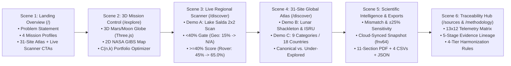

# TERRATWIN — PHASE 7.1: JUDGE EXPERIENCE STORYBOARD
**Project:** TerraTwin — Planetary Analog Discovery & Research Platform  
**Team:** HEXARCHY (Six Members)  
**Purpose:** Visual and interactive storyboard mapping the complete judge experience across TerraTwin’s routes (`/`, `/explore`, `/discover`, `/sources`, `/methodology`), ensuring every transition reinforces scientific credibility and mission utility.

---

## 1. End-to-End Judge Journey Flow

---

## 2. Scene-by-Scene Visual & Interaction Storyboard

### Scene 1 — First Impression & Problem Framing (`http://localhost:3000/`)
- **Duration:** `0:00 – 0:30`
- **Visual State on Screen:**
  - Top header with `TERRATWIN // NASA APPS`, live UTC/Mars Sol Mission Clock, navigation links (`Overview`, `Explorer`, `Discovery Scanner`, `Data Sources`, `Methodology`), and researcher session badge.
  - Hero section displaying interactive Moon/Mars target quick-switcher (`Jezero Crater Delta` and `Mare Tranquillitatis`), real deterministic telemetry preview, and primary action buttons (**Launch Explorer Terminal** $\rightarrow$ `/explore` and **Discovery Scanner** $\rightarrow$ `/discover`).
  - Stat strip showing **12** Environmental Parameters, **31** Curated Global Atlas Sites (+ Live Regional Scanner), **100%** Deterministic Scoring (`\ge 40\%` Coverage Gate), and **4** Mission Profiles.
- **Judge Takeaway:** Immediately understands that TerraTwin is a deterministic scientific platform addressing the NASA Space Apps Challenge (*"Identify Earth Locations that Analog the Permanent Moon Base Locations and Mars"*).

---

### Scene 2 — 3D Planetary Reconnaissance & Multi-Site Portfolio Synergy (`http://localhost:3000/explore`)
- **Duration:** `0:30 – 1:45`
- **User Actions:**
  1. Click **Mars** $\rightarrow$ select **Gale Crater (Aeolis Mons)** or **Jezero Crater Delta**; watch the Three.js 3D Mars globe rotate smoothly via spherical linear interpolation (`slerp`) and lock onto the landing site.
  2. In the right 2D Earth GIS pane, toggle **NASA GIBS WMTS** layers (`MODIS Terra True Color`, `Vegetation Index (NDVI)`, `Day Land Surface Temp`). Point out the explicit provenance banner distinguishing visual GIBS browse imagery from calibrated numerical scoring data.
  3. Click **Mission Suite // Multi-Site Optimizer** $\rightarrow$ select **Pair (2 Sites)** under `Rover testing & trafficability` for Gale Crater.
  4. Scroll to the **Scientific Analysis View** and switch across **Terrain Workspace** (5-axis radar chart), **Elevation Transects** (MOLA/LOLA binary DEM vs. Copernicus 90m geodesic profile in Relative Relief $\Delta z$), and **Evidence Explorer** (5-stage sensor lineage).
- **Verified Numbers Shown on Screen:**
  - Single-site top rank for Gale Crater (`rover-testing`): **Lake Salda (`82.1%`, `95%` coverage)**, **Atacama Desert (`80.6%`, `100%` coverage)**.
  - 2-Site Portfolio rank #1 for Gale Crater (`rover-testing`): **Atacama Desert + Haughton Impact Structure = `90.3%` composite similarity** (`+9.7%` synergy gain over Atacama alone and `+8.2%` over Lake Salda).
- **Judge Takeaway:** Sees how 3D planetary altimetry, 2D Earth remote sensing, and combinatorial portfolio math solve the fundamental problem that no single Earth site replicates an entire planet.

---

### Scene 3 — Live Regional Discovery & Honest Missing-Data Handling (`http://localhost:3000/discover` — Demo A)
- **Duration:** `1:45 – 3:00`
- **User Actions:**
  1. Navigate to `/discover` (or click the **Demo A: Mars Jezero · Lake Salda** quick-load button in the Judge Demo Walkthrough bar).
  2. With **Jezero Crater Delta**, **Geological field research**, and **Lake Salda, Turkey** (`2×2` grid, 4 cells) selected, click **Launch Discovery Scan**.
  3. Observe the honest `<40%` coverage result (`15%` coverage, `Insufficient data to rank reliably`), explaining that Macrostrat’s global map returns `"Pliocene undifferentiated"` (`lithology: null`), so TerraTwin refuses to guess a geological rank.
  4. Switch the mission profile to **Rover testing & trafficability** and click **Launch Discovery Scan** again.
  5. Observe the 4 grid cells update to **`45%` coverage** (`\ge 40\%` gate) with an exploratory similarity score of **`65.0% (Exploratory)`** (`isVerified: false`, `live-grid-discovery`).
- **Judge Takeaway:** Witnesses real-time multi-provider ingestion (Open-Meteo Copernicus DEM 5-point slope + NASA POWER 25-year climatology + Macrostrat geology) paired with uncompromising scientific honesty when evidence coverage is below 40%.

---

### Scene 4 — Lunar Base Siting & 31-Site Global Discovery Atlas (`http://localhost:3000/discover` — Demos B & C)
- **Duration:** `3:00 – 4:00`
- **User Actions:**
  1. Click **Curated Atlas** (`31 Curated Global Sites`) on `/discover`.
  2. **Demo B (Lunar South Pole):** Select **Lunar base sites** $\rightarrow$ **Shackleton Crater Rim** $\rightarrow$ **Lunar base construction & ISRU**. Inspect **McMurdo Dry Valleys**, **Mauna Kea Summit & Saddle**, and **Hanksville / Qaidam**, and open **Scientific Intelligence** to show the explicit **29.5-Earth-day synodic illumination** and hard-vacuum limitation disclosures.
  3. **Demo C (Global Atlas Diversity):** Switch back to **Jezero Crater Delta** + **Geological field research**, filter across the **9 Analog Environment Categories** and **Novelty Tiers** (`8 Canonical Benchmarks` vs. `23 Under-Explored Analogs` across `18 Countries`), highlighting under-explored candidates like **Tibetan Plateau — Qinghai (`92.3%`)**, **Svalbard — Spitsbergen (`91.7%`)**, **Ebro Basin Paleo-Fluvial Deltas (`90.2%`)**, and **Lonar Basaltic Crater, India**.
- **Judge Takeaway:** Confirms broad global geographic coverage (18 countries, 9 environment types) and clear visual separation between curated sites and unverified live-grid leads.

---

### Scene 5 — Scientific Intelligence, Cloud Research Workspace & 6-Format Exports (`http://localhost:3000/discover`)
- **Duration:** `4:00 – 4:40`
- **User Actions:**
  1. In **Scientific Intelligence**, show the **Feature Contributions**, **Mismatch Diagnostics**, **Validation Checklist**, and **Bounded $\pm 25\%$ Weight Sensitivity Analysis**.
  2. In **Research Workspace & Validation Reports**, click **Create Research Assessment Snapshot**.
  3. Point out the **Snapshot ID (`ttw-snap-...`)**, **FNV-1a 64-bit Integrity Digest (`fnv64-...`)**, **Supabase Cloud RLS Sync status**, **Research Tasks** (`observationStatus: "recommended-not-completed"`), and **User-Authored Research Notes** (explicitly separated from measured telemetry).
  4. Click **Download Scientific PDF** (11-section report), **Export Candidate CSV**, **Export Feature & Provenance CSV**, **Export Research Tasks CSV**, **Export Provenance Manifest CSV**, and **Export Snapshot JSON**.
- **Judge Takeaway:** Sees that TerraTwin produces actionable, tamper-evident, publication-ready scientific outputs rather than ephemeral screen displays.

---

### Scene 6 — Complete Data Traceability & Methodology Defense (`/sources` & `/methodology`)
- **Duration:** `4:40 – 5:00` (and during Judge Q&A)
- **User Actions:**
  1. Open `/sources` to display the **13×12 Verified Telemetry Matrix**, **Dataset Archive Cards**, and **4-Tier Harmonization Guide**.
  2. Open `/methodology` to display the exact **Linear, Logarithmic ($\log_{10}$), and Categorical equations**, **Mission Profile Weight Vectors**, and **Known Scientific Limitations**.
- **Judge Takeaway:** Every equation, weight, tolerance, and dataset citation is transparent and immediately verifiable during Q&A.
